# Anmelden im Vereinsportal – Anleitung für Hallenbucher

Diese Anleitung ist für alle, die **kein Vereinsmitglied** sind und Hallen- oder Freiplätze buchen möchten. Im Portal heißen Sie „Externer Hallennutzer“. Die Anleitung zeigt Schritt für Schritt, wie Sie sich registrieren und was Sie tun, wenn Sie Ihr Passwort vergessen haben.

Sie sind Vereinsmitglied? Dann nutzen Sie bitte die Anleitung für Mitglieder.

> **Gut zu wissen**
>
> - Die Bilder zeigen das Vereinsportal mit einer erfundenen Person (Hannes Beispiel). Bei Ihnen stehen dort Ihre eigenen Angaben.
> - Die roten Zahlen in den Bildern zeigen, in welcher Reihenfolge Sie etwas ausfüllen oder anklicken.
> - „Kennwort“ und „Passwort“ bedeuten dasselbe.
> - Ein Kennwort muss mindestens 10 Zeichen lang sein.

**Inhalt**

1. Neu registrieren
2. Ich hatte schon ein Konto im alten Buchungssystem (EP3)
3. Der Verein hat meinen Zugang schon angelegt
4. Passwort vergessen
5. Was tun, wenn …

## 1. Neu registrieren

Die Registrierung dauert etwa 5 Minuten. Sie brauchen Zugriff auf Ihr E-Mail-Postfach.

### Schritt 1: Registrierung öffnen

Öffnen Sie die Anmeldeseite des Portals. Klicken Sie ganz unten auf **Zum Vereinsportal registrieren**.

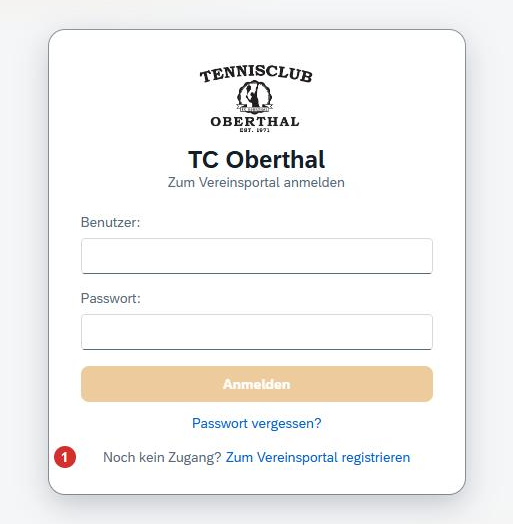

### Schritt 2: Formular ausfüllen

1. Wählen Sie **Externer Hallennutzer (kein Mitglied)**.

Füllen Sie dann alle Felder mit Stern (*) aus: Anrede, Vorname, Nachname, Straße mit Hausnummer, PLZ, Ort und E-Mail. Die Telefonnummer ist freiwillig.

Wählen Sie einen **Benutzernamen**. Wird das Feld grün, ist der Name frei.

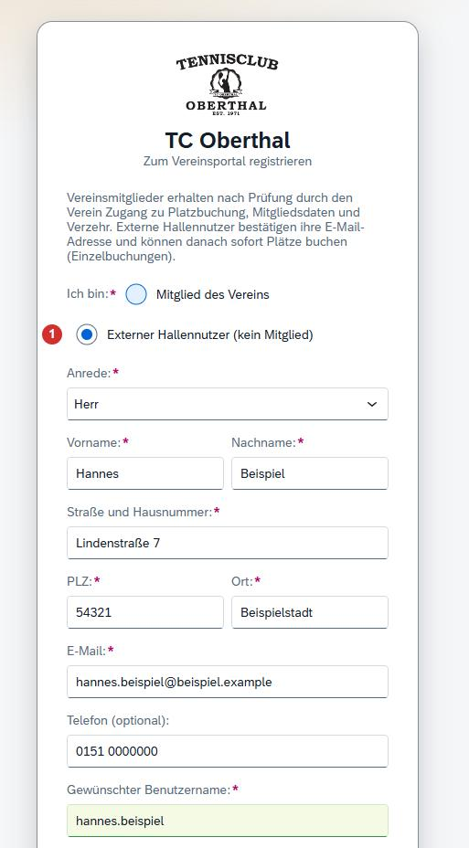

### Schritt 3: Kennwort wählen und absenden

Tippen Sie Ihr Kennwort zweimal ein (mindestens 10 Zeichen). Wenn Sie möchten, schreiben Sie dem Verein eine kurze Mitteilung.

1. Setzen Sie das Häkchen beim Einverständnis.
2. Klicken Sie auf **Registrierung absenden**.

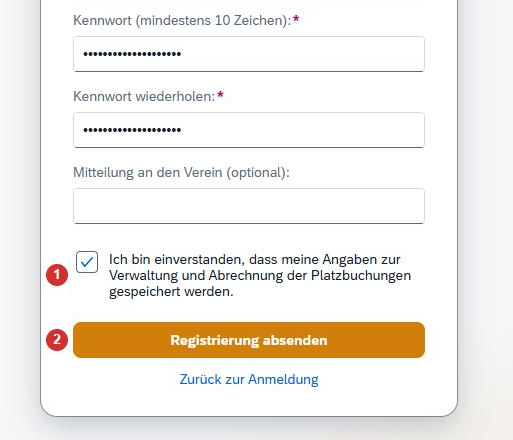

### Schritt 4: Meldung lesen

Das Portal zeigt eine grüne Meldung. Sie bekommen jetzt eine E-Mail.

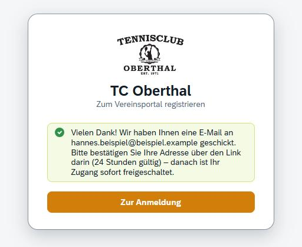

### Schritt 5: E-Mail-Adresse bestätigen

Öffnen Sie die E-Mail mit dem Betreff „Bitte bestätigen Sie Ihre Registrierung“. Klicken Sie auf den Link.

- Der Link gilt **24 Stunden**.
- Ohne diesen Klick wird kein Zugang angelegt.

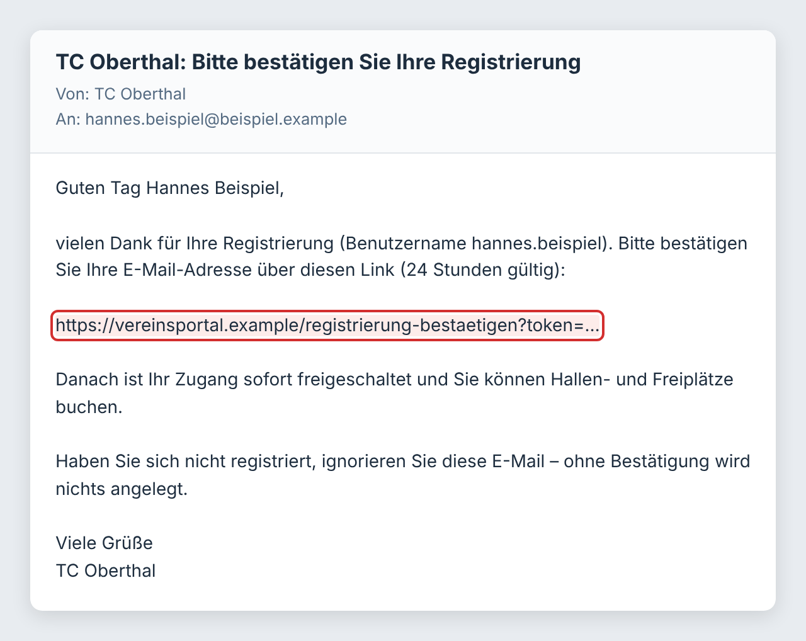

### Schritt 6: Fertig

Das Portal bestätigt Ihre E-Mail-Adresse. Ihr Zugang ist **sofort** freigeschaltet. Klicken Sie auf **Zur Anmeldung**.

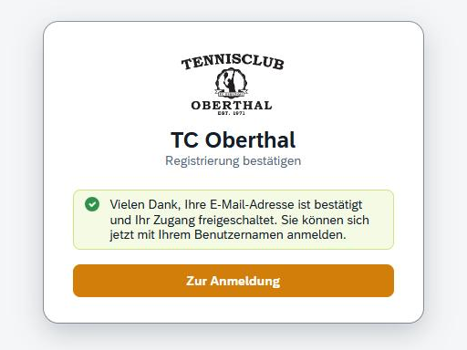

### Schritt 7: Anmelden

Tragen Sie Ihren Benutzernamen und Ihr Kennwort ein. Klicken Sie auf **Anmelden**. Danach können Sie Plätze buchen.

Tipp: Statt des Benutzernamens können Sie auch Ihre E-Mail-Adresse eintragen.

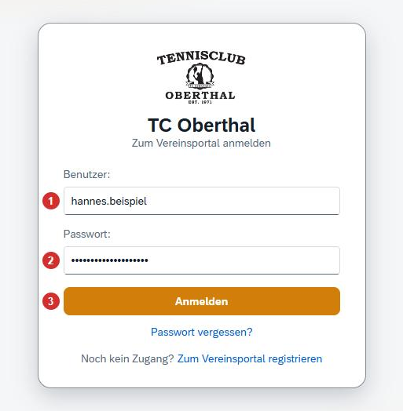

### Sonderfall: Meldung „wird vom Verein geprüft“

Manchmal kann das Portal keine Bestätigungs-E-Mail verschicken. Dann steht in der grünen Meldung, dass der Verein Ihre Registrierung prüft. Sie müssen nichts weiter tun. Sobald der Verein Sie freigegeben hat, können Sie sich anmelden.

## 2. Ich hatte schon ein Konto im alten Buchungssystem (EP3)

Sie haben früher schon online Plätze gebucht? Dann gibt es zwei Möglichkeiten.

### Möglichkeit 1: Einfach anmelden

Der Verein hat viele Konten aus dem alten System übernommen. Probieren Sie es zuerst so:

- **Benutzer:** Ihre E-Mail-Adresse
- **Passwort:** Ihr bisheriges Kennwort

Klappt das nicht? Nutzen Sie **Passwort vergessen** (Kapitel 4). Kommt dabei keine E-Mail an, haben Sie noch kein Konto im Portal. Nehmen Sie dann Möglichkeit 2.

### Möglichkeit 2: Bei der Registrierung das alte Konto angeben

Registrieren Sie sich wie in Kapitel 1. Unter dem Benutzernamen sehen Sie ein zusätzliches Kästchen. (Es erscheint nur, wenn der Verein Konten aus dem alten System übernommen hat.)

1. Setzen Sie das Häkchen bei **Ich habe bereits ein Konto im bisherigen Buchungssystem (EP3)**.
2. Tragen Sie Ihren alten Benutzernamen oder Ihre E-Mail-Adresse ein.
3. Tragen Sie Ihr altes Kennwort ein.
4. Ein neues Kennwort ist freiwillig. Lassen Sie das Feld leer, gilt Ihr altes Kennwort weiter.

Ihr Vorteil: Ihre bisherigen Buchungen bleiben erhalten.

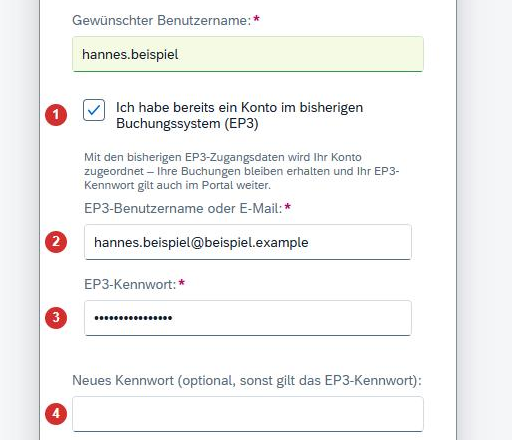

## 3. Der Verein hat meinen Zugang schon angelegt

Manchmal legt der Verein den Zugang für Sie an. Dann müssen Sie sich nicht registrieren. Es gibt zwei Fälle:

### Fall 1: E-Mail mit Link „Kennwort festlegen“

Sie bekommen eine E-Mail mit Ihrem Anmeldenamen und einem Link. Klicken Sie auf den Link und tippen Sie Ihr eigenes Kennwort zweimal ein. Der Link gilt **48 Stunden** und nur einmal.

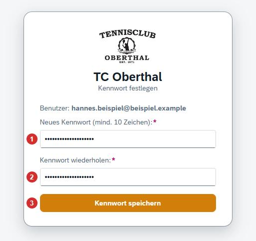

### Fall 2: Startkennwort vom Verein

Sie haben vom Verein einen Anmeldenamen und ein Startkennwort bekommen. Melden Sie sich damit an. Das Portal fragt dann sofort nach einem eigenen Kennwort:

1. Startkennwort eintragen.
2. Neues Kennwort eintragen.
3. Neues Kennwort wiederholen.
4. **Passwort ändern** anklicken.

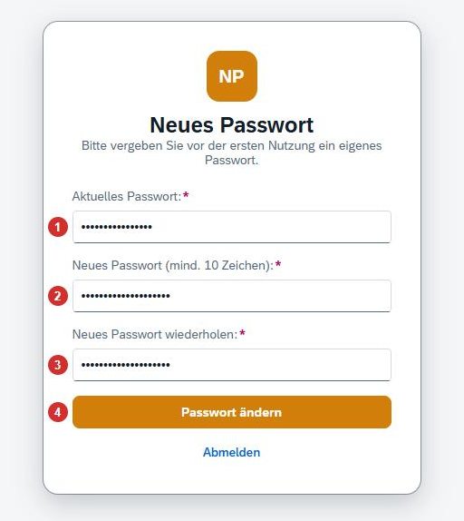

## 4. Passwort vergessen

Sie wissen Ihr Kennwort nicht mehr? Dann vergeben Sie einfach ein neues. Sie brauchen dafür nur Zugriff auf Ihr E-Mail-Postfach.

### Schritt 1: „Passwort vergessen?“ anklicken

Öffnen Sie die Anmeldeseite des Portals. Klicken Sie unter dem blauen Knopf auf **Passwort vergessen?**

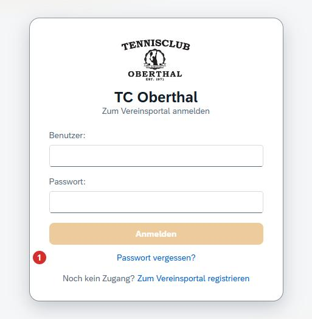

### Schritt 2: Benutzername oder E-Mail eingeben

Tragen Sie Ihren Benutzernamen oder Ihre E-Mail-Adresse ein. Klicken Sie dann auf **Link anfordern**.

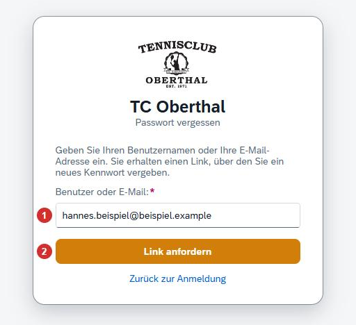

### Schritt 3: Meldung lesen

Das Portal zeigt eine grüne Meldung. Diese Meldung erscheint immer – auch wenn Sie sich vertippt haben. So kann niemand ausprobieren, wer ein Konto hat.

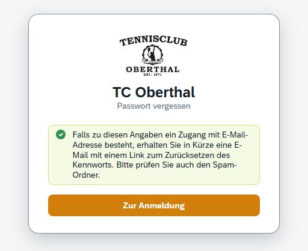

### Schritt 4: E-Mail öffnen und Link anklicken

Sie bekommen eine E-Mail mit dem Betreff „Kennwort zurücksetzen“. Klicken Sie auf den Link in der E-Mail.

- Der Link gilt **60 Minuten**.
- Der Link funktioniert **nur einmal**.

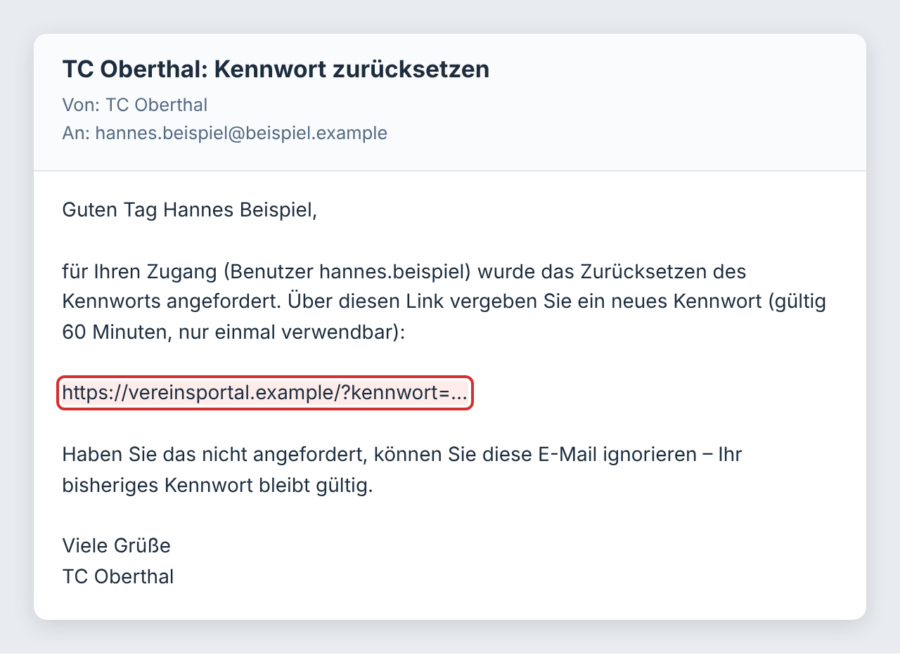

### Schritt 5: Neues Kennwort eingeben

Tippen Sie Ihr neues Kennwort zweimal ein. Klicken Sie dann auf **Kennwort speichern**.

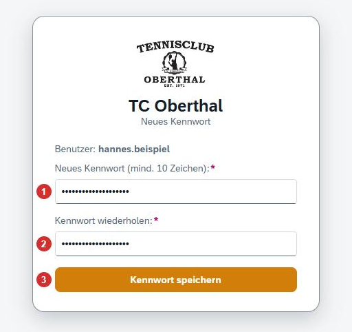

### Schritt 6: Anmelden

Das Kennwort ist gespeichert. Klicken Sie auf **Zur Anmeldung** und melden Sie sich mit dem neuen Kennwort an.

Zur Sicherheit werden Sie dabei auf allen Geräten abgemeldet, auf denen Sie noch angemeldet waren.

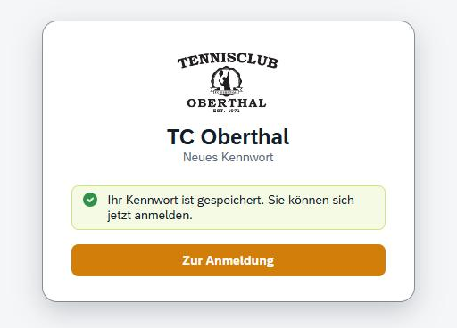

## 5. Was tun, wenn …

| Problem | Lösung |
|---|---|
| Es kommt keine E-Mail an. | Warten Sie ein paar Minuten. Schauen Sie auch im Spam-Ordner nach. Prüfen Sie, ob Sie die E-Mail-Adresse richtig geschrieben haben. |
| Der Link ist „ungültig, abgelaufen oder wurde bereits verwendet“. | Jeder Link gilt nur eine bestimmte Zeit und nur einmal. Bestätigungslink abgelaufen: Registrieren Sie sich bitte noch einmal. Link für das Kennwort abgelaufen: Klicken Sie auf der Anmeldeseite noch einmal auf „Passwort vergessen?“. Das gilt auch für den Link „Kennwort festlegen“. |
| Nach „Passwort vergessen“ kommt keine E-Mail. | Geben Sie statt der E-Mail-Adresse Ihren Benutzernamen ein. Das ist nötig, wenn mehrere Personen dieselbe E-Mail-Adresse nutzen (zum Beispiel in einer Familie). Kommt weiterhin nichts, ist bei Ihrem Zugang vielleicht keine E-Mail-Adresse gespeichert – melden Sie sich dann beim Verein. |
| Der gewünschte Benutzername ist schon vergeben. | Wählen Sie einen anderen Namen, zum Beispiel mit einer Zahl am Ende. Erlaubt sind Buchstaben, Ziffern, Punkt, Unterstrich und Bindestrich. Der Name braucht mindestens 3 Zeichen. |
| Der blaue Knopf lässt sich nicht anklicken. | Es fehlt noch eine Angabe. Prüfen Sie alle Felder mit Stern (*), das Häkchen beim Einverständnis und ob beide Kennwörter gleich und mindestens 10 Zeichen lang sind. |
| „Zu viele Fehlversuche“ | Nach 10 falschen Eingaben ist die Anmeldung kurz gesperrt. Warten Sie 15 Minuten. Nutzen Sie danach „Passwort vergessen?“. |
| Ich weiß meinen Benutzernamen nicht mehr. | Sie können sich auch mit Ihrer E-Mail-Adresse anmelden. |

Kommen Sie nicht weiter? Dann wenden Sie sich bitte an Ihren Verein.
