# Anmelden im Vereinsportal – Anleitung für Mitglieder

Diese Anleitung zeigt Schritt für Schritt, wie Sie als **Vereinsmitglied** Ihren Zugang zum Vereinsportal einrichten und was Sie tun, wenn Sie Ihr Passwort vergessen haben.

> **Gut zu wissen**
>
> - Die Bilder zeigen das Vereinsportal mit einer erfundenen Person (Martina Muster). Bei Ihnen stehen dort Ihre eigenen Angaben.
> - Die roten Zahlen in den Bildern zeigen, in welcher Reihenfolge Sie etwas ausfüllen oder anklicken.
> - „Kennwort“ und „Passwort“ bedeuten dasselbe.
> - Ein Kennwort muss mindestens 10 Zeichen lang sein.

**Inhalt**

1. Welcher Weg passt zu mir?
2. Weg A: Einladung vom Verein
3. Weg B: Schnellweg ohne Einladung
4. Weg C: Vollständige Registrierung
5. Der Verein hat meinen Zugang schon angelegt
6. Passwort vergessen
7. Was tun, wenn …

## 1. Welcher Weg passt zu mir?

Es gibt drei Wege zu Ihrem Zugang. Sie brauchen nur **einen** davon.

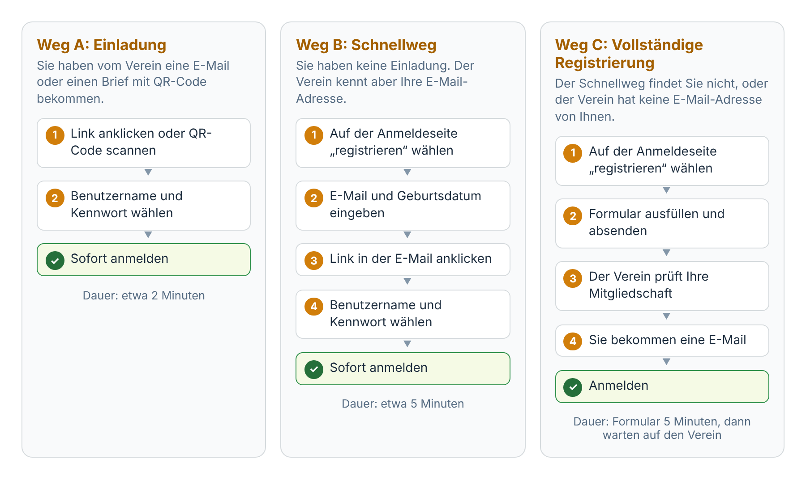

- Sie haben eine **Einladung** bekommen (E-Mail oder Brief)? Nehmen Sie **Weg A**.
- Sie haben keine Einladung? Probieren Sie **Weg B**. Das geht am schnellsten.
- Weg B hat Sie nicht gefunden? Dann führt Sie das Portal von selbst zu **Weg C**.

## 2. Weg A: Einladung vom Verein

Der Verein hat Ihnen eine E-Mail oder einen Brief mit einem persönlichen Link und einem QR-Code geschickt.

### Schritt 1: Link anklicken oder QR-Code scannen

- **E-Mail:** Klicken Sie auf den Link in der E-Mail.
- **Brief:** Scannen Sie den QR-Code mit der Kamera Ihres Handys.

Die Einladung gilt **30 Tage** und nur für Sie. Sie funktioniert nur einmal. Bitte geben Sie sie nicht weiter.

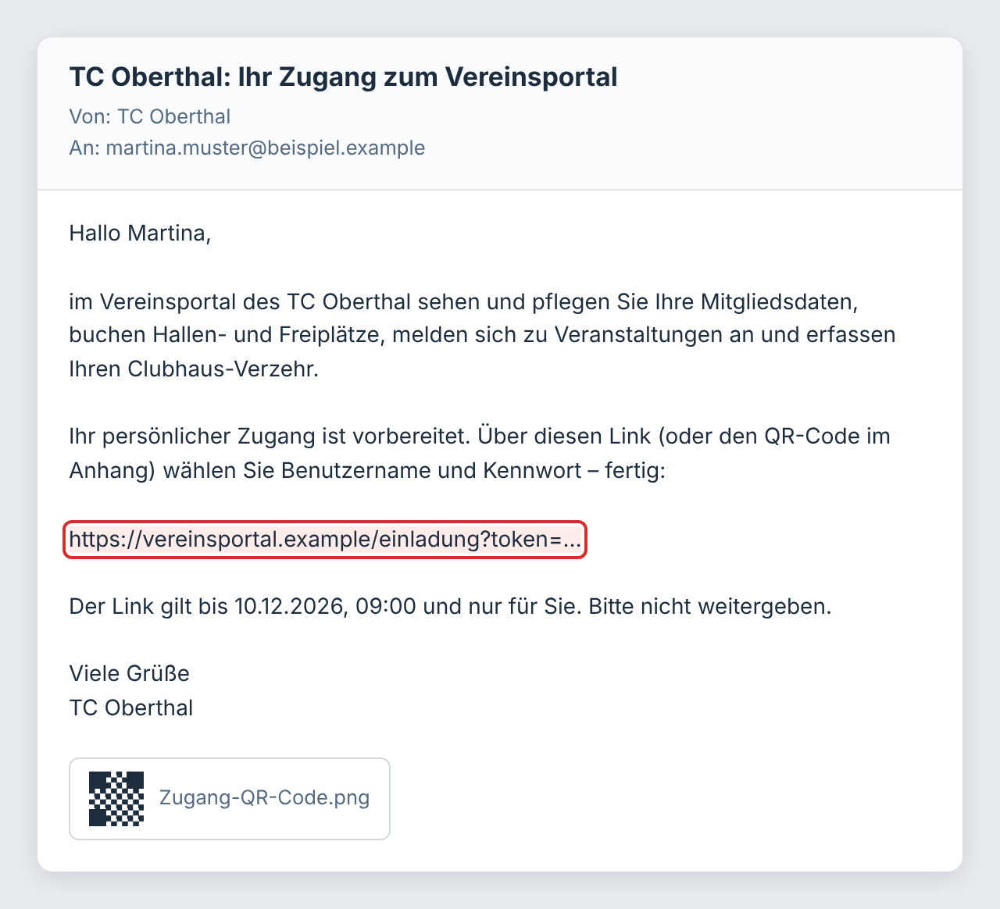

### Schritt 2: Benutzername und Kennwort wählen

Das Portal begrüßt Sie mit Ihrem Namen.

1. **Benutzername:** Das Portal schlägt einen Namen vor. Sie können ihn so lassen oder ändern.
2. **Kennwort:** Denken Sie sich ein Kennwort mit mindestens 10 Zeichen aus.
3. **Kennwort wiederholen:** Tippen Sie dasselbe Kennwort noch einmal ein.
4. Setzen Sie das Häkchen beim Einverständnis.
5. Klicken Sie auf **Zugang einrichten**.

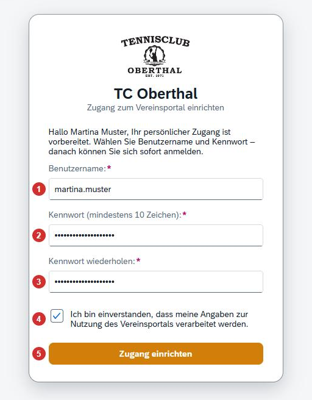

### Schritt 3: Fertig

Das Portal zeigt eine grüne Meldung. Ihr Zugang ist sofort bereit. Klicken Sie auf **Zur Anmeldung**.

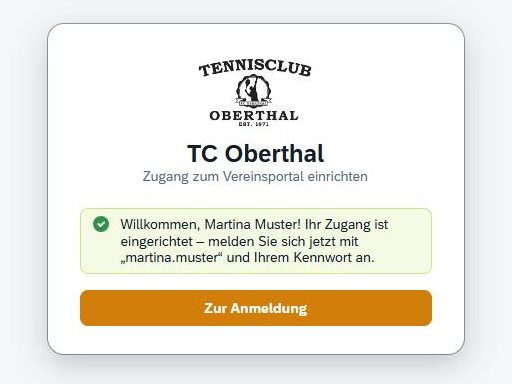

### Schritt 4: Anmelden

Tragen Sie Ihren Benutzernamen und Ihr Kennwort ein. Klicken Sie auf **Anmelden**.

Tipp: Statt des Benutzernamens können Sie auch Ihre E-Mail-Adresse eintragen.

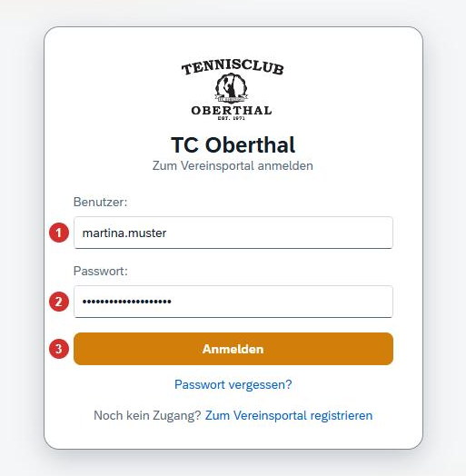

## 3. Weg B: Schnellweg ohne Einladung

Dieser Weg funktioniert, wenn der Verein Ihre E-Mail-Adresse und Ihr Geburtsdatum kennt. Sie müssen dann nicht auf eine Freigabe warten.

### Schritt 1: Registrierung öffnen

Öffnen Sie die Anmeldeseite des Portals. Klicken Sie ganz unten auf **Zum Vereinsportal registrieren**.

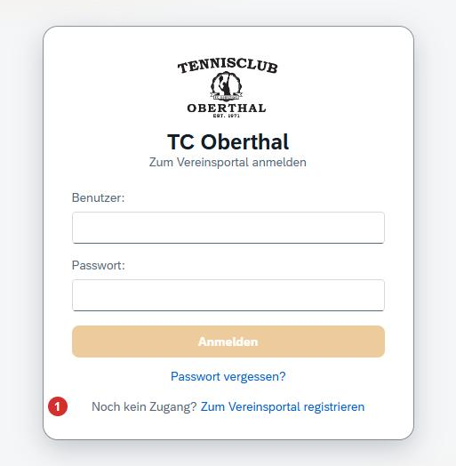

### Schritt 2: E-Mail und Geburtsdatum eingeben

1. Wählen Sie **Mitglied des Vereins**.
2. Tragen Sie die E-Mail-Adresse ein, die der Verein von Ihnen hat.
3. Tragen Sie Ihr Geburtsdatum ein.
4. Klicken Sie auf **Weiter**.

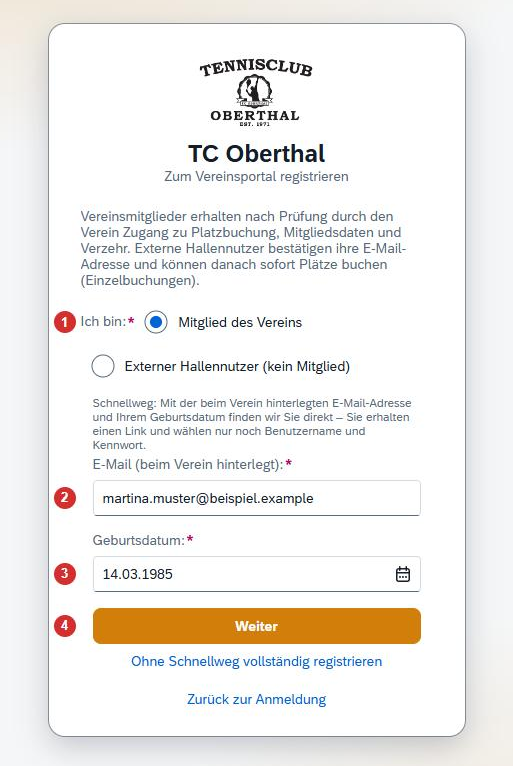

### Schritt 3: E-Mail öffnen

Hat das Portal Sie gefunden, sehen Sie eine grüne Meldung. Sie bekommen eine E-Mail mit einem Link. Der Link gilt **24 Stunden**.

Sehen Sie stattdessen einen blauen Hinweis und ein längeres Formular? Dann hat das Portal Sie nicht gefunden. Machen Sie mit **Weg C** weiter.

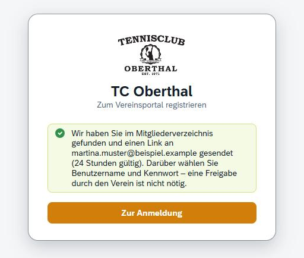

### Schritt 4: Benutzername und Kennwort wählen, anmelden

Klicken Sie auf den Link in der E-Mail. Ab hier geht es weiter wie bei **Weg A, Schritt 2 bis 4**: Benutzername und Kennwort wählen, Einverständnis ankreuzen, **Zugang einrichten** anklicken, anmelden.

## 4. Weg C: Vollständige Registrierung

Diesen Weg brauchen Sie, wenn der Schnellweg Sie nicht findet. Das passiert zum Beispiel, wenn der Verein eine andere E-Mail-Adresse von Ihnen hat. Hier prüft ein Mensch im Verein Ihre Angaben. Das kann etwas dauern.

So kommen Sie hierher: wie bei Weg B, Schritt 1 und 2. Das Formular erscheint von selbst, wenn der Schnellweg Sie nicht findet. Sie können auch direkt auf **Ohne Schnellweg vollständig registrieren** klicken.

### Schritt 1: Mitgliedschaft nachweisen

Der Verein muss Sie im Mitgliederverzeichnis wiederfinden. Wählen Sie dafür **eine** Angabe:

1. **Geburtsdatum** oder **Mitgliedsnummer** auswählen.
2. Die gewählte Angabe eintragen.

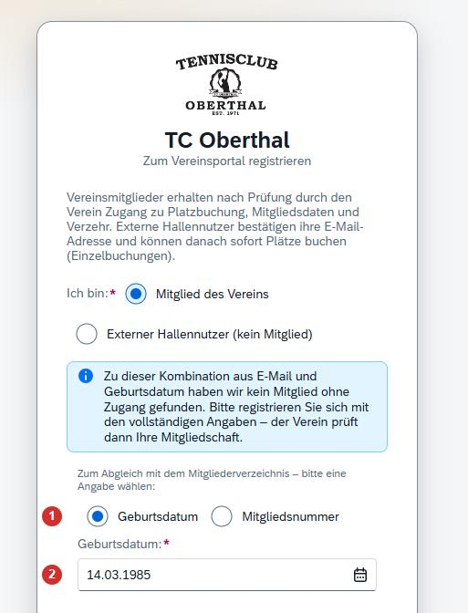

### Schritt 2: Persönliche Angaben ausfüllen

Füllen Sie alle Felder mit Stern (*) aus: Anrede, Vorname, Nachname, Straße mit Hausnummer, PLZ, Ort und E-Mail. Die Telefonnummer ist freiwillig.

Wählen Sie dann einen **Benutzernamen**. Wird das Feld grün, ist der Name frei.

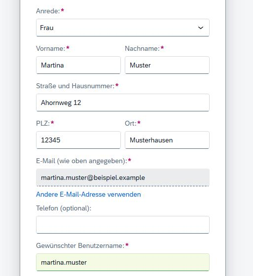

### Schritt 3: Kennwort wählen und absenden

Tippen Sie Ihr Kennwort zweimal ein (mindestens 10 Zeichen). Wenn Sie möchten, schreiben Sie dem Verein eine kurze Mitteilung.

1. Setzen Sie das Häkchen beim Einverständnis.
2. Klicken Sie auf **Registrierung absenden**.

Sehen Sie im Formular zusätzlich das Kästchen „Ich habe bereits ein Konto im bisherigen Buchungssystem (EP3)“? Das brauchen Sie nur, wenn Sie früher schon online Plätze gebucht haben. Mit Ihren alten Zugangsdaten bleiben Ihre bisherigen Buchungen erhalten.

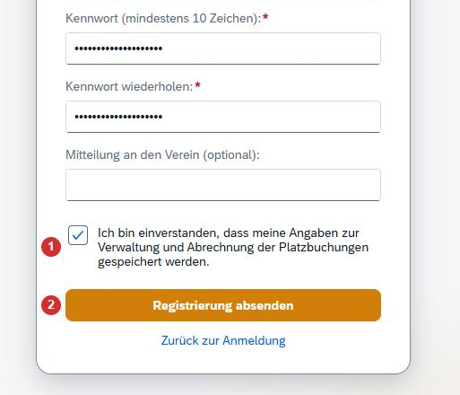

### Schritt 4: Auf die Freigabe warten

Das Portal bestätigt den Eingang. Sie müssen jetzt nichts weiter tun. Der Verein prüft Ihre Mitgliedschaft.

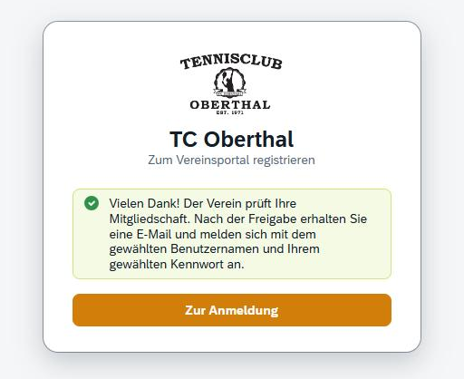

### Schritt 5: E-Mail abwarten und anmelden

Sobald der Verein Sie freigegeben hat, bekommen Sie eine E-Mail. Danach melden Sie sich mit Ihrem Benutzernamen und Ihrem Kennwort an.

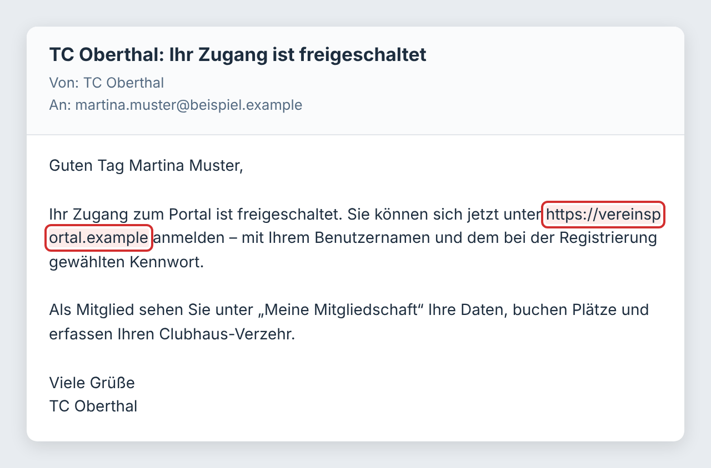

## 5. Der Verein hat meinen Zugang schon angelegt

Manchmal legt der Verein den Zugang für Sie an. Dann müssen Sie sich nicht registrieren. Es gibt zwei Fälle:

### Fall 1: E-Mail mit Link „Kennwort festlegen“

Sie bekommen eine E-Mail mit Ihrem Anmeldenamen und einem Link. Klicken Sie auf den Link und tippen Sie Ihr eigenes Kennwort zweimal ein. Der Link gilt **48 Stunden** und nur einmal.

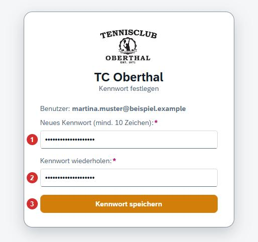

### Fall 2: Startkennwort vom Verein

Sie haben vom Verein einen Anmeldenamen und ein Startkennwort bekommen. Melden Sie sich damit an. Das Portal fragt dann sofort nach einem eigenen Kennwort:

1. Startkennwort eintragen.
2. Neues Kennwort eintragen.
3. Neues Kennwort wiederholen.
4. **Passwort ändern** anklicken.

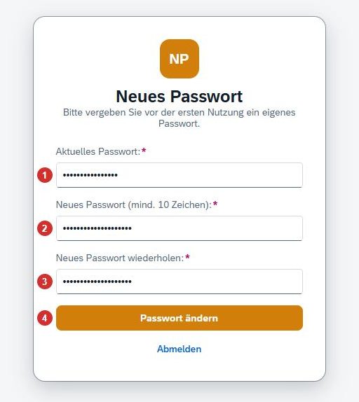

## 6. Passwort vergessen

Sie wissen Ihr Kennwort nicht mehr? Dann vergeben Sie einfach ein neues. Sie brauchen dafür nur Zugriff auf Ihr E-Mail-Postfach.

### Schritt 1: „Passwort vergessen?“ anklicken

Öffnen Sie die Anmeldeseite des Portals. Klicken Sie unter dem blauen Knopf auf **Passwort vergessen?**

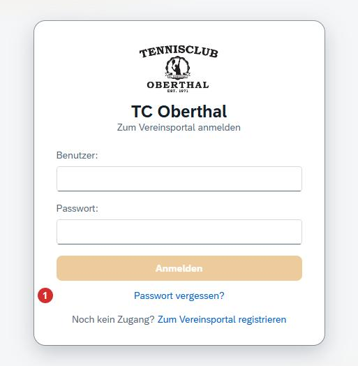

### Schritt 2: Benutzername oder E-Mail eingeben

Tragen Sie Ihren Benutzernamen oder Ihre E-Mail-Adresse ein. Klicken Sie dann auf **Link anfordern**.

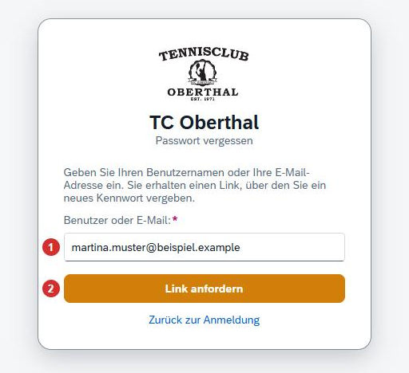

### Schritt 3: Meldung lesen

Das Portal zeigt eine grüne Meldung. Diese Meldung erscheint immer – auch wenn Sie sich vertippt haben. So kann niemand ausprobieren, wer ein Konto hat.

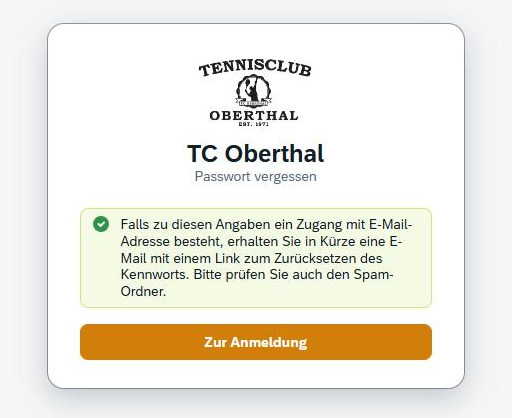

### Schritt 4: E-Mail öffnen und Link anklicken

Sie bekommen eine E-Mail mit dem Betreff „Kennwort zurücksetzen“. Klicken Sie auf den Link in der E-Mail.

- Der Link gilt **60 Minuten**.
- Der Link funktioniert **nur einmal**.

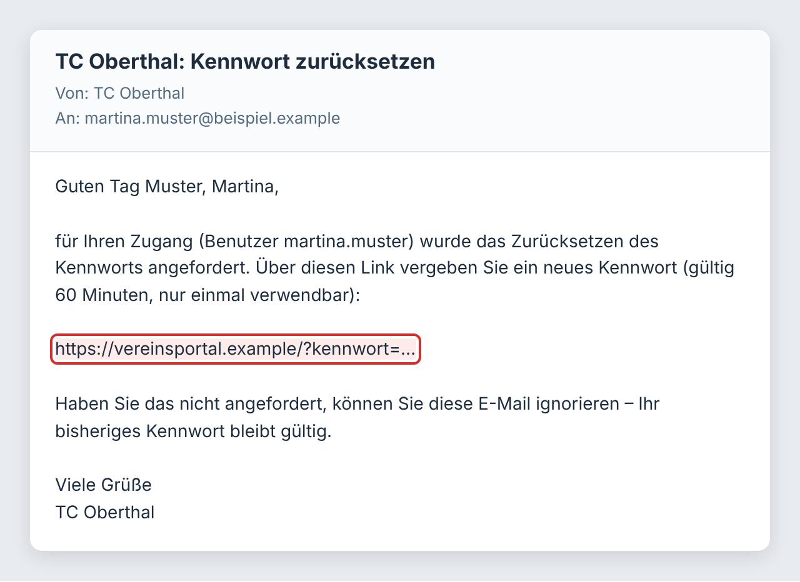

### Schritt 5: Neues Kennwort eingeben

Tippen Sie Ihr neues Kennwort zweimal ein. Klicken Sie dann auf **Kennwort speichern**.

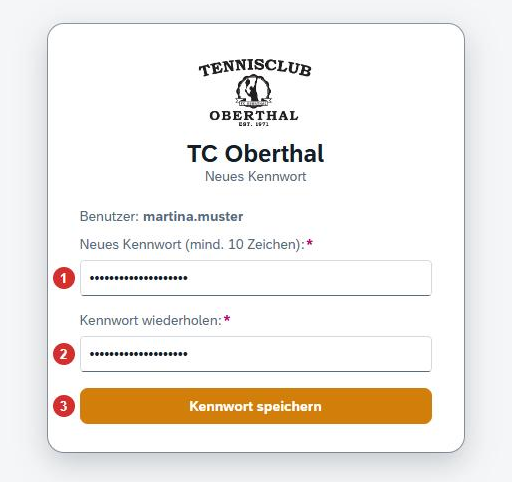

### Schritt 6: Anmelden

Das Kennwort ist gespeichert. Klicken Sie auf **Zur Anmeldung** und melden Sie sich mit dem neuen Kennwort an.

Zur Sicherheit werden Sie dabei auf allen Geräten abgemeldet, auf denen Sie noch angemeldet waren.

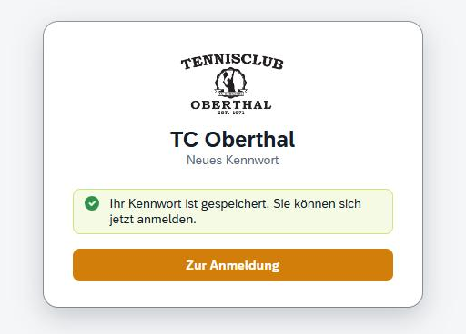

## 7. Was tun, wenn …

| Problem | Lösung |
|---|---|
| Es kommt keine E-Mail an. | Warten Sie ein paar Minuten. Schauen Sie auch im Spam-Ordner nach. Prüfen Sie, ob Sie die E-Mail-Adresse richtig geschrieben haben. |
| Der Link ist „ungültig, abgelaufen oder wurde bereits verwendet“. | Jeder Link gilt nur eine bestimmte Zeit und nur einmal. Einladung abgelaufen: Bitten Sie den Verein um eine neue Einladung oder nutzen Sie Weg B. Link vom Schnellweg abgelaufen: Wiederholen Sie Weg B. Link für das Kennwort abgelaufen: Klicken Sie auf der Anmeldeseite noch einmal auf „Passwort vergessen?“. |
| Nach „Passwort vergessen“ kommt keine E-Mail. | Geben Sie statt der E-Mail-Adresse Ihren Benutzernamen ein. Das ist nötig, wenn mehrere Personen dieselbe E-Mail-Adresse nutzen (zum Beispiel in einer Familie). Kommt weiterhin nichts, ist bei Ihrem Zugang vielleicht keine E-Mail-Adresse gespeichert – melden Sie sich dann beim Verein. |
| Der gewünschte Benutzername ist schon vergeben. | Wählen Sie einen anderen Namen, zum Beispiel mit einer Zahl am Ende. Erlaubt sind Buchstaben, Ziffern, Punkt, Unterstrich und Bindestrich. Der Name braucht mindestens 3 Zeichen. |
| Der blaue Knopf lässt sich nicht anklicken. | Es fehlt noch eine Angabe. Prüfen Sie alle Felder mit Stern (*), das Häkchen beim Einverständnis und ob beide Kennwörter gleich und mindestens 10 Zeichen lang sind. |
| „Zu viele Fehlversuche“ | Nach 10 falschen Eingaben ist die Anmeldung kurz gesperrt. Warten Sie 15 Minuten. Nutzen Sie danach „Passwort vergessen?“. |
| Ich weiß meinen Benutzernamen nicht mehr. | Sie können sich auch mit Ihrer E-Mail-Adresse anmelden. |

Kommen Sie nicht weiter? Dann wenden Sie sich bitte an Ihren Verein.
