# Halle buchen im Vereinsportal – Anleitung

Diese Anleitung zeigt Schritt für Schritt, wie Sie im Vereinsportal einen Platz buchen, eine Buchung ändern oder stornieren und was die Anzeige im Kalender bedeutet. Sie gilt für Hallenbucher und für Mitglieder.

Sie haben noch keinen Zugang? Dann lesen Sie zuerst die Anleitung „Anmelden im Vereinsportal“.

> **Gut zu wissen**
>
> - Die Bilder zeigen das Vereinsportal mit einer erfundenen Person (Hannes Beispiel). Bei Ihnen stehen dort Ihre eigenen Angaben.
> - Die roten Zahlen in den Bildern zeigen, worauf Sie achten oder was Sie anklicken.
> - Zeiten, Fristen und Preise in den Bildern sind der Stand vom November 2026. Der Verein kann sie ändern. Es gilt immer, was im Buchungsfenster steht.
> - Das Portal funktioniert auch auf dem Handy. Dort sehen die Seiten etwas schmaler aus, die Schritte sind dieselben.

**Inhalt**

1. „Platz buchen“ öffnen
2. Der Kalender auf einen Blick
3. Einen Platz buchen
4. Was kostet meine Buchung?
5. Eine Buchung ändern
6. Eine Buchung stornieren
7. Meine Buchungen ansehen
8. Abos
9. Meine Daten
10. Was tun, wenn …

## 1. „Platz buchen“ öffnen

### Schritt 1: Anmelden und Kachel anklicken

Melden Sie sich im Vereinsportal an. Auf der Startseite klicken Sie auf die Kachel **Platz buchen**.

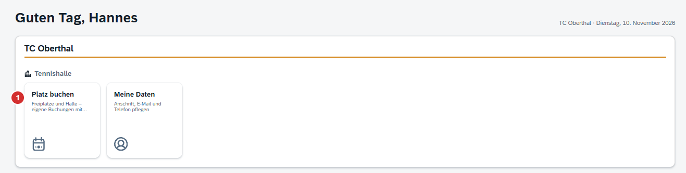

### Schritt 2: Der Kalender erscheint

Sie sehen jetzt den Kalender. Links im Menü kommen Sie jederzeit wieder zu **Platz buchen** zurück.

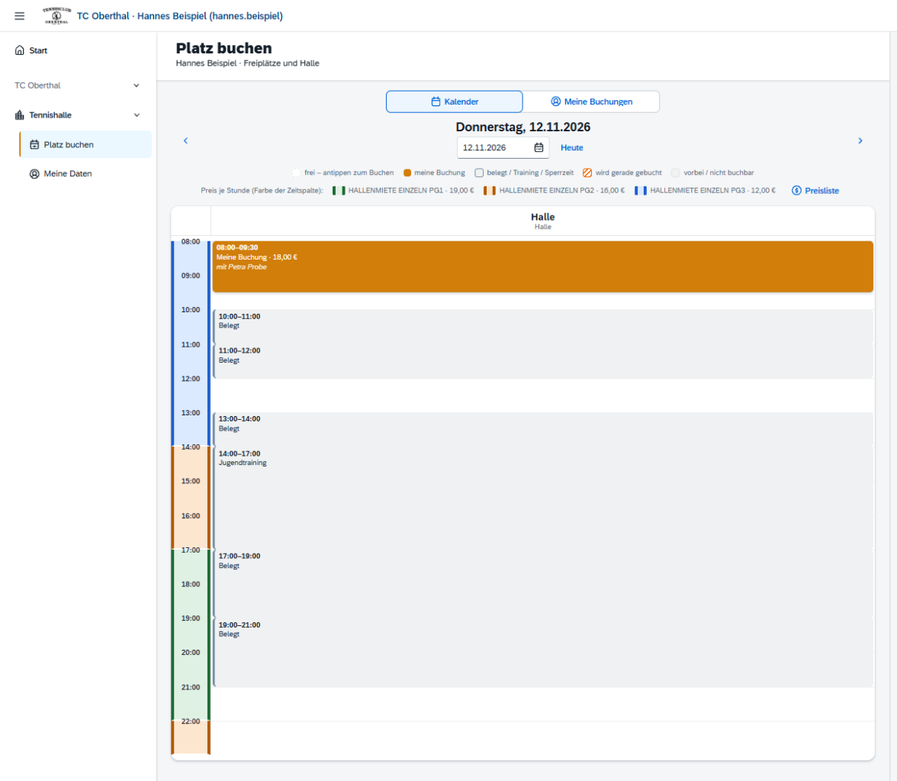

## 2. Der Kalender auf einen Blick

Der Kalender zeigt immer **einen Tag**. Jeder Platz hat eine eigene Spalte. Links stehen die Uhrzeiten.

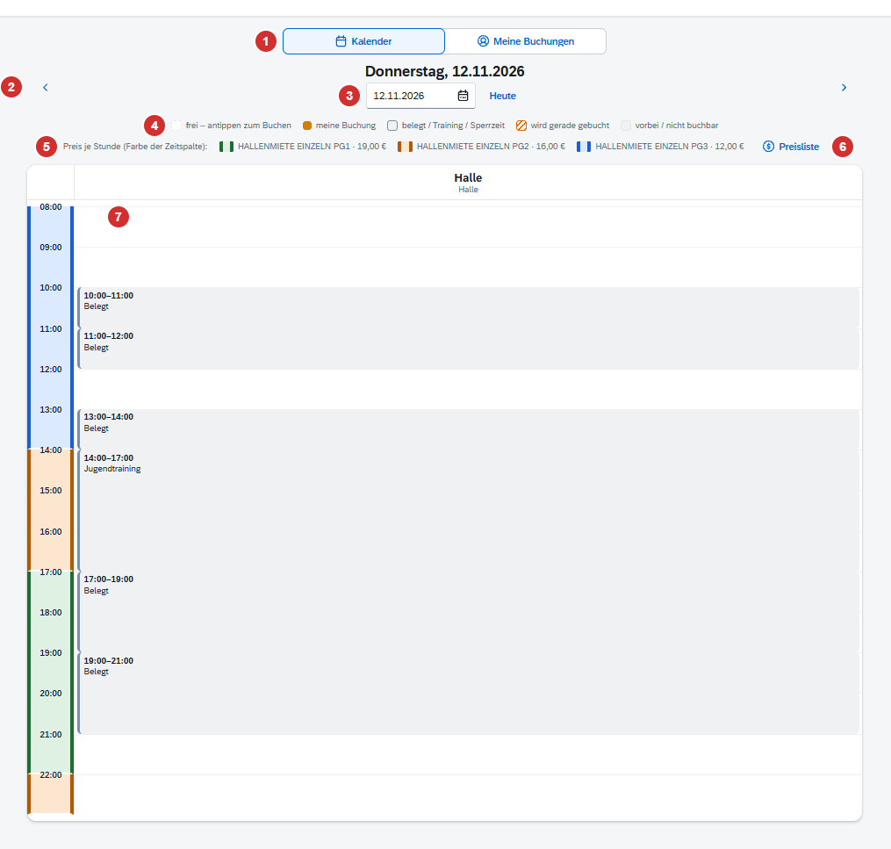

1. **Kalender / Meine Buchungen:** Hier wechseln Sie zwischen dem Kalender und der Liste Ihrer Buchungen.
2. **Pfeile:** einen Tag zurück oder einen Tag weiter.
3. **Datum:** Hier wählen Sie direkt einen bestimmten Tag. Mit **Heute** springen Sie zurück zum heutigen Tag.
4. **Farben im Kalender:** siehe Tabelle unten.
5. **Preis je Stunde:** Die Farbe neben der Uhrzeit zeigt, welcher Preis zu welcher Zeit gilt.
6. **Preisliste:** zeigt die Preise der ganzen Woche (siehe Kapitel 4).
7. **Weiße Fläche:** Hier ist der Platz frei. Ein Klick darauf startet die Buchung.

| So sieht es aus | Das bedeutet es |
|---|---|
| weiß | Der Platz ist frei. Antippen zum Buchen. |
| orange, „Meine Buchung“ | Ihre eigene Buchung. Antippen zum Ändern oder Stornieren. |
| grau, „Belegt“ | Jemand anderes hat gebucht. Wer das ist, sehen Sie nicht. |
| grau, mit Bezeichnung (zum Beispiel „Jugendtraining“) | Training, Veranstaltung oder Sperrzeit des Vereins. |
| orange gestreift, „Wird gerade gebucht“ | Jemand anderes bucht diese Zeit in diesem Moment. |
| hellgrau, „vorbei“ oder „nicht mehr buchbar“ | Die Zeit ist vorbei oder liegt zu kurz vor dem Beginn. |

Gibt es Hallen- und Freiplätze, erscheinen über dem Kalender zusätzlich die Knöpfe **Alle Plätze**, **Halle** und **Freiplätze**. Damit blenden Sie Plätze ein oder aus.

Der Kalender lädt sich alle 30 Sekunden selbst neu. Sie müssen die Seite nicht aktualisieren.

## 3. Einen Platz buchen

### Schritt 1: Tag wählen und freie Zeit anklicken

Wählen Sie im Kalender den gewünschten Tag. Klicken Sie dann auf eine **weiße Fläche** zur gewünschten Uhrzeit. Es öffnet sich das Fenster „Platz buchen“.

### Schritt 2: Angaben prüfen

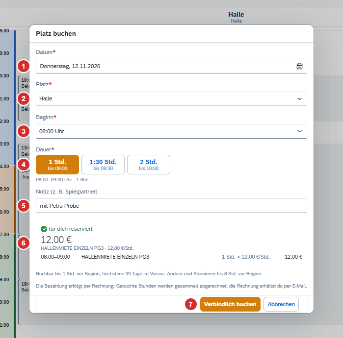

1. **Datum:** Der gewählte Tag. Sie können ihn hier noch ändern.
2. **Platz:** Der gewählte Platz.
3. **Beginn:** Die Uhrzeit, zu der Sie anfangen möchten.
4. **Dauer:** Klicken Sie auf die gewünschte Dauer. Unter jeder Dauer steht, bis wann Sie dann spielen.
5. **Notiz:** Freiwillig. Hier können Sie zum Beispiel Ihren Spielpartner eintragen. Die Notiz sehen nur Sie und der Verein.
6. **Preis:** Hier steht, was die Buchung kostet und wie sich der Preis berechnet.
7. **Verbindlich buchen:** Erst mit diesem Knopf ist der Platz gebucht.

Unter dem Preis stehen die Regeln für diesen Platz: bis wann Sie buchen können, wie weit im Voraus und bis wann Ändern und Stornieren möglich ist.

> **„für dich reserviert“**
>
> Solange das Fenster offen ist, hält das Portal die Zeit für Sie frei. Andere sehen im Kalender „Wird gerade gebucht“ und können diese Zeit nicht nehmen. Schließen Sie das Fenster mit **Abbrechen**, ist die Zeit wieder frei.

### Schritt 3: Verbindlich buchen

Klicken Sie auf **Verbindlich buchen**. Unten erscheint kurz eine Bestätigung. Ihre Buchung steht jetzt orange im Kalender, mit Uhrzeit, Preis und Ihrer Notiz.

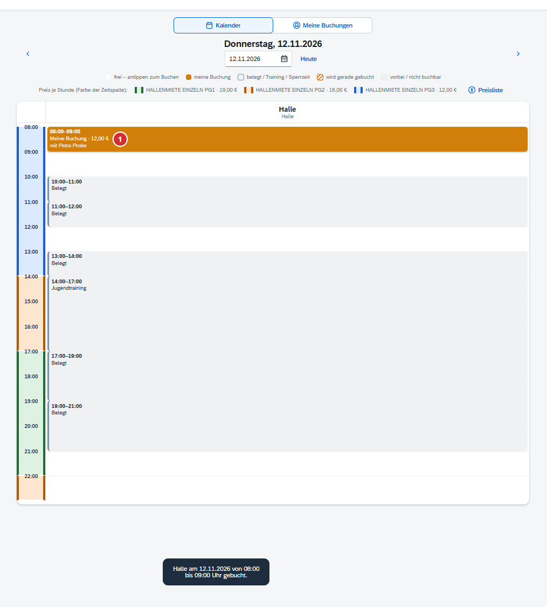

## 4. Was kostet meine Buchung?

Der Preis hängt von der Uhrzeit und vom Wochentag ab. Den genauen Betrag sehen Sie immer **vor** dem Buchen im Buchungsfenster.

- **Halle:** Es gibt mehrere Preisklassen. Welche gerade gilt, zeigt die Farbe neben der Uhrzeit.
- **Freiplätze:** kostenfrei.
- **Bezahlung:** Sie bezahlen nicht im Portal. Der Verein rechnet die gebuchten Stunden gesammelt ab. Die Rechnung kommt per E-Mail.

### Buchung über mehrere Preisklassen

Reicht Ihre Buchung von einer Preisklasse in die nächste, rechnet das Portal jeden Teil einzeln und zeigt die Summe.

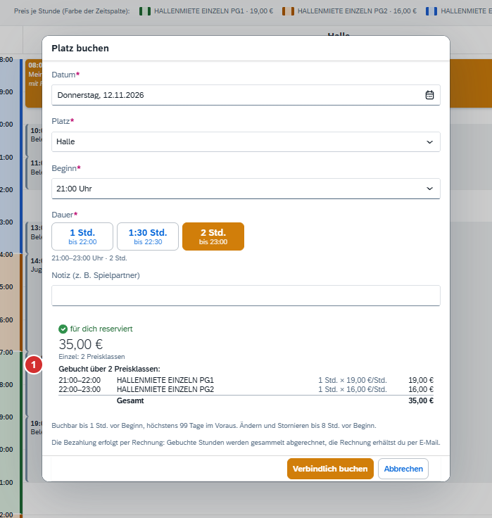

### Die Preisliste der Woche

Klicken Sie über dem Kalender auf **Preisliste**. Sie sehen für jeden Wochentag, zu welcher Uhrzeit welcher Stundenpreis gilt. Mit **Schließen** kommen Sie zurück zum Kalender.

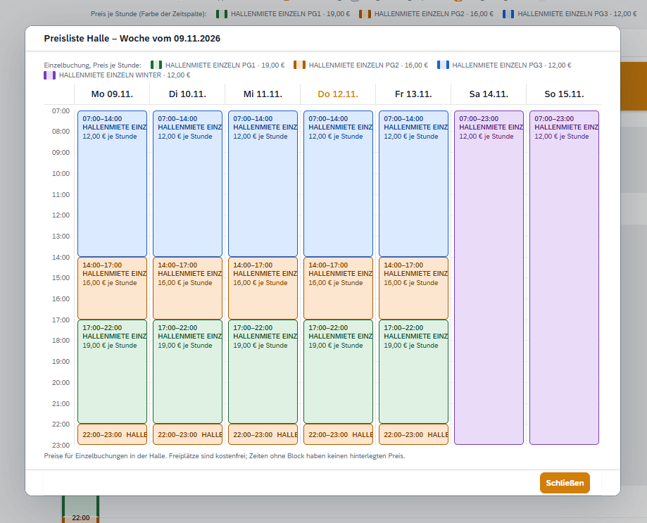

## 5. Eine Buchung ändern

Sie können Datum, Platz, Beginn, Dauer und Notiz ändern – solange die Frist nicht abgelaufen ist. Die Frist steht im Buchungsfenster („Ändern und Stornieren bis … Std. vor Beginn“).

### Schritt 1: Eigene Buchung anklicken

Klicken Sie im Kalender auf Ihre orange Buchung. Oder klicken Sie unter **Meine Buchungen** auf die Buchung mit dem Stift-Symbol.

### Schritt 2: Ändern und speichern

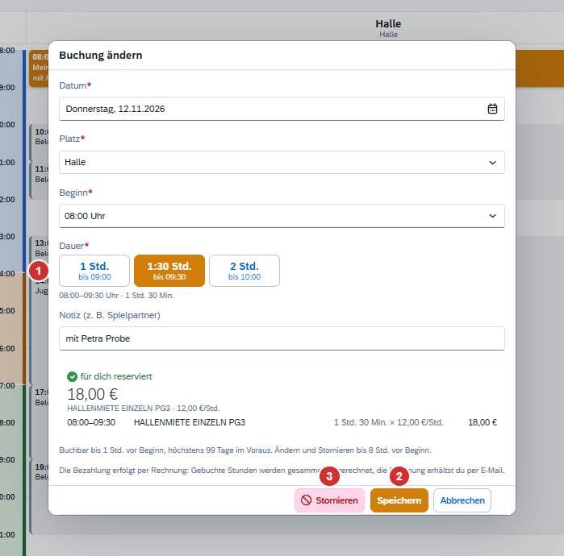

1. Ändern Sie, was Sie möchten – im Bild die Dauer. Der Preis wird sofort neu berechnet.
2. Klicken Sie auf **Speichern**.
3. Mit **Stornieren** sagen Sie die Buchung ganz ab (siehe Kapitel 6).

## 6. Eine Buchung stornieren

### Schritt 1: Buchung öffnen und „Stornieren“ anklicken

Öffnen Sie die Buchung wie in Kapitel 5. Klicken Sie unten auf **Stornieren**.

### Schritt 2: Bestätigen

Das Portal fragt zur Sicherheit nach. Klicken Sie noch einmal auf **Stornieren**.

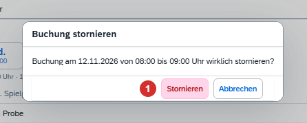

### Schritt 3: Fertig

Der Platz ist wieder frei für andere. In der Liste **Meine Buchungen** steht die Buchung durchgestrichen mit dem Hinweis „storniert“.

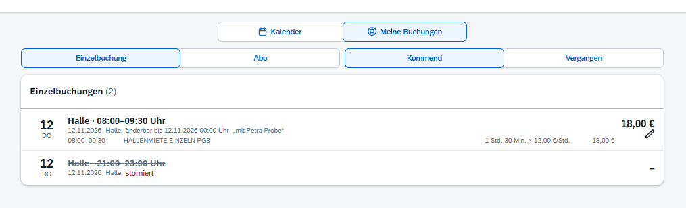

## 7. Meine Buchungen ansehen

Klicken Sie oben auf **Meine Buchungen**. Sie sehen alle Ihre Buchungen als Liste.

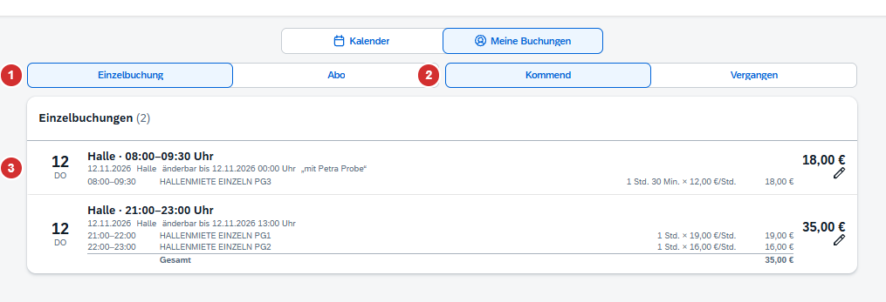

1. **Einzelbuchung / Abo:** Wählen Sie, welche Art von Buchungen Sie sehen möchten.
2. **Kommend / Vergangen:** Zukünftige oder frühere Buchungen.
3. **Eine Buchung:** Tag, Platz, Uhrzeit und rechts der Preis. Darunter steht, wie sich der Preis berechnet.

Weitere Hinweise in der Liste:

| Hinweis | Bedeutung |
|---|---|
| Stift-Symbol | Sie können diese Buchung noch ändern oder stornieren. Einfach anklicken. |
| „änderbar bis …“ | Bis zu diesem Zeitpunkt sind Ändern und Stornieren möglich. |
| „storniert“ | Die Buchung wurde abgesagt. |
| „abgerechnet“ | Die Buchung steht schon auf einer Rechnung. Sie lässt sich nicht mehr ändern. |
| „aus EP3“ | Die Buchung stammt aus dem früheren Buchungssystem. Sie lässt sich im Portal nicht ändern. |

## 8. Abos

Ein Abo ist eine feste Zeit, die sich jede Woche wiederholt.

- Abos legt **der Verein** an. Sie können im Portal kein Abo selbst buchen, ändern oder stornieren.
- Für ein neues Abo oder eine Änderung melden Sie sich bitte beim Vorstand.
- Ihre Abos sehen Sie unter **Meine Buchungen → Abo**: Wochentag, Uhrzeit, Zeitraum, Anzahl der Termine, nächster Termin und Abo-Preis.
- Im Kalender stehen Ihre Abo-Termine orange mit dem Text „Mein Abo“.

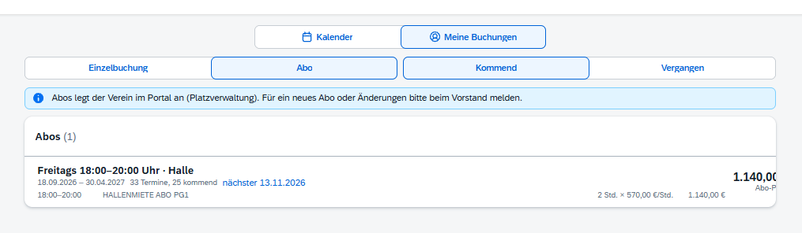

## 9. Meine Daten

Als Hallenbucher pflegen Sie Ihre Kontaktdaten selbst. Klicken Sie links im Menü auf **Meine Daten**. Ändern Sie Anschrift, E-Mail oder Telefon und klicken Sie auf **Speichern**.

Wichtig: An die E-Mail-Adresse schickt der Verein Ihre Rechnungen. Sie gilt auch für die Anmeldung und für „Passwort vergessen“.

Mitglieder finden ihre Daten stattdessen unter „Meine Mitgliedschaft“.

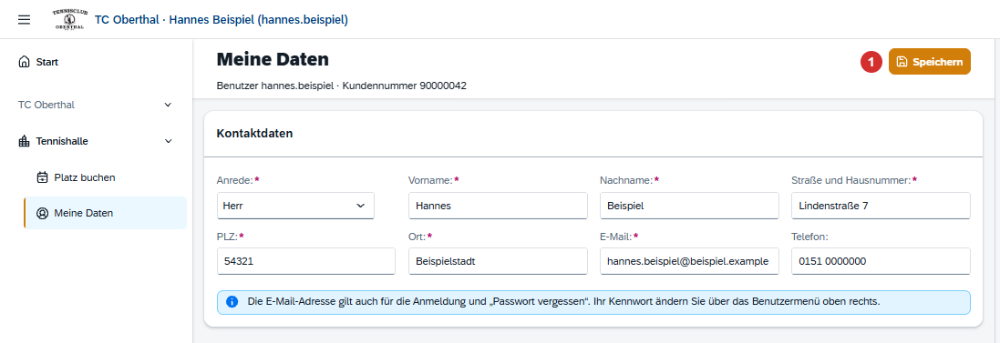

## 10. Was tun, wenn …

Passt eine Zeit nicht, zeigt das Buchungsfenster eine rote Meldung. Der Knopf **Verbindlich buchen** ist dann grau.

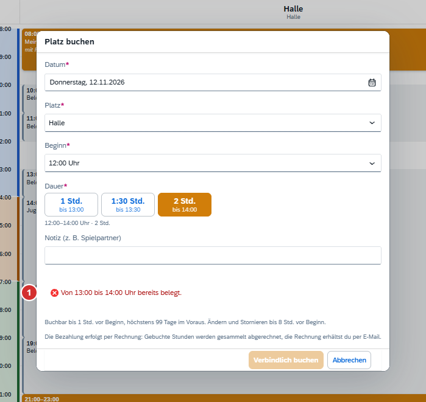

| Meldung oder Problem | Lösung |
|---|---|
| „Von … bis … Uhr bereits belegt.“ | Ihre Buchung würde in eine belegte Zeit reichen. Wählen Sie eine kürzere Dauer, einen anderen Beginn oder einen anderen Tag. |
| „… wird gerade von jemand anderem gebucht.“ | Jemand anderes hat diese Zeit gerade im Buchungsfenster. Wählen Sie eine andere Zeit oder versuchen Sie es kurz danach noch einmal. |
| Im Kalender steht „nicht mehr buchbar“. | Die Zeit liegt zu kurz vor dem Beginn. Buchen Sie eine spätere Zeit. |
| Im Kalender steht „buchbar höchstens … Tage im Voraus“. | Der Tag liegt zu weit in der Zukunft. Buchen Sie später noch einmal. |
| Ein Platz ist grau mit dem Hinweis „geschlossen“. | Der Platz ist an diesem Wochentag oder zu dieser Jahreszeit nicht buchbar. |
| „Mindestdauer …“ oder „Höchstdauer …“ | Wählen Sie eine der angebotenen Dauern. |
| „Auf … sind höchstens … kommende Buchung(en) gleichzeitig möglich.“ | Sie haben schon so viele offene Buchungen, wie der Verein erlaubt. Spielen oder stornieren Sie zuerst eine davon. |
| „Ändern und Stornieren ist nur bis … Stunde(n) vor Beginn möglich.“ | Die Frist ist abgelaufen. Bitte wenden Sie sich an den Verein. |
| „Die Buchung ist bereits abgerechnet.“ | Die Buchung steht schon auf einer Rechnung. Bitte wenden Sie sich an den Verein. |
| „Die Bearbeitung wurde wegen Inaktivität beendet …“ | Das Fenster war zu lange offen. Klicken Sie auf **Erneut reservieren**. |
| Ich möchte ein Abo. | Abos legt der Verein an. Bitte melden Sie sich beim Vorstand. |

Kommen Sie nicht weiter? Dann wenden Sie sich bitte an Ihren Verein.
