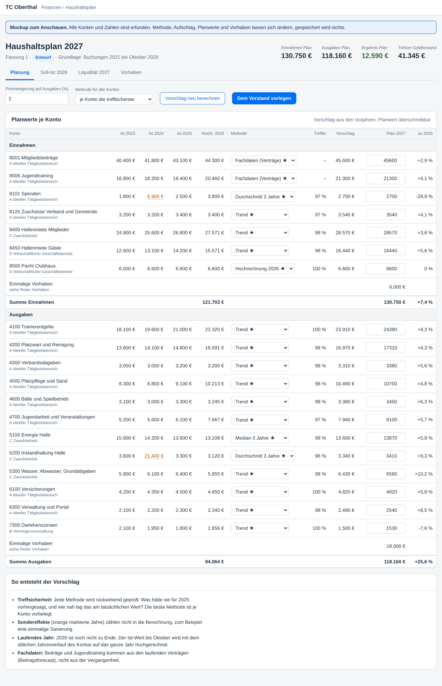
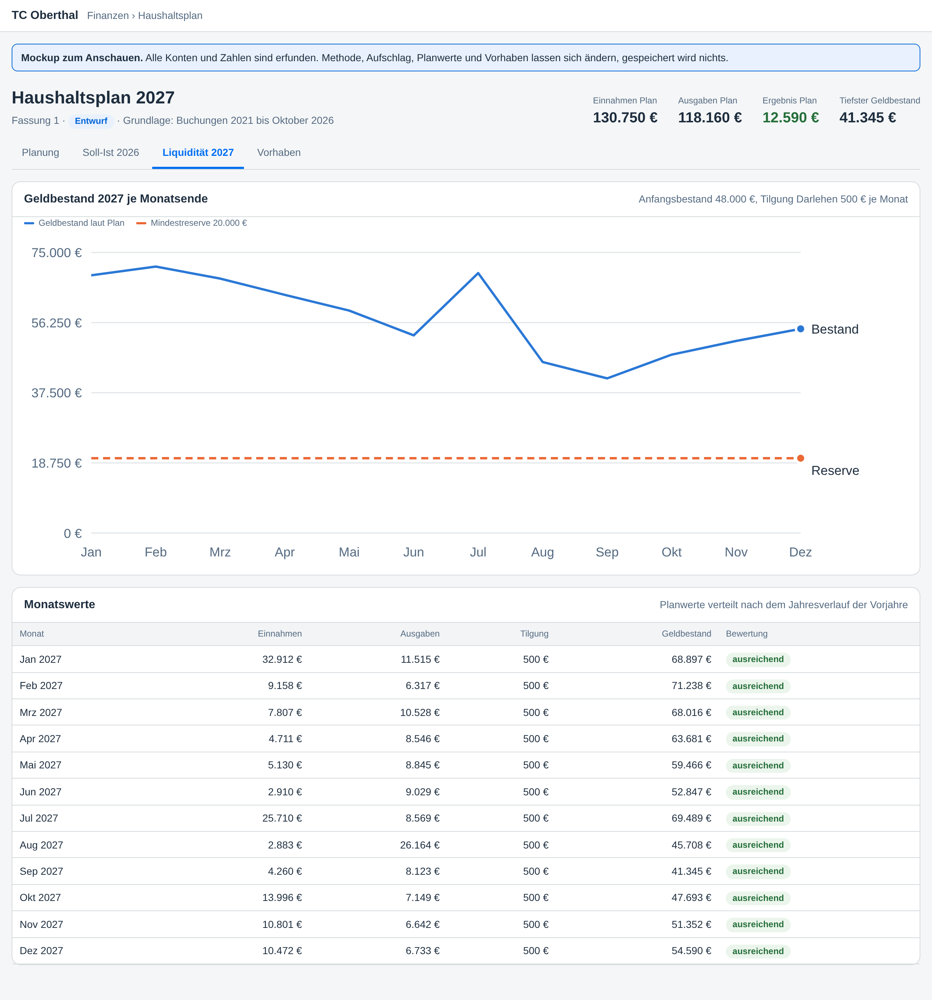

# Haushaltsplan – Konzept (Stand 15.11.2026)

Dieses Dokument beschreibt, wie ein Haushaltsplan (Budget je Konto mit Soll-Ist-Vergleich) in das Vereinsportal passt.
**Es ist noch nichts davon umgesetzt.** Zum Anschauen gibt es ein klickbares Mockup mit erfundenen Zahlen:
[`mockup.html`](mockup.html) (Datei herunterladen und im Browser öffnen), Bildschirmfotos stehen unten.

## 1 Ziel

Der Vorstand legt im Herbst fest, mit welchen Einnahmen und Ausgaben er im Folgejahr rechnet, lässt den Plan beschließen und
sieht während des Jahres, wo der Verein davon abweicht. Heute zeigt das Portal nur, was war (Einnahmen & Ausgaben,
Jahresabschluss) und was an Beiträgen zu erwarten ist (Beitragsforecast). Ein Planwert je Konto fehlt.

Leitgedanke: **Der Plan entsteht als Vorschlag aus den vorhandenen Buchungen** und wird nur dort von Hand geändert, wo der
Vorstand es besser weiß. Niemand soll 30 Konten aus dem Kopf füllen müssen.

## 2 Worauf der Plan aufbaut

| Vorhandene Daten | Wo | Verwendung im Haushaltsplan |
|---|---|---|
| Buchungen je Konto, Jahr und Monat | `tco.fibuchungen` (Soll/Haben, auch die aus SAP übernommenen Jahre) | Ist-Werte der Vorjahre, Jahresverlauf je Konto, Ist im laufenden Jahr |
| Kontenstamm mit Kennzahl und Verrechnungskonto | `tco.fikonten` | Gliederung nach Tätigkeitsbereich A–D wie im Jahresabschluss; Verdichtung (z. B. Gas/Wasser/Strom) |
| Kontenverwendung je Geschäftsjahr | `tco.fikontojahr` | nur aktive Konten werden geplant |
| Einnahme/Ausgabe/Geldkonto | `kontoart()` in `finanz/logik.ts` | dieselbe Abgrenzung wie in „Einnahmen & Ausgaben“, damit Plan und Ist zusammenpassen |
| Laufende Verträge und Beitragsstamm | Beitragsforecast (`forecast/logik.ts`) | Planwert für Mitgliedsbeiträge und Jugendtraining aus den Verträgen statt aus der Vergangenheit |
| Geldbestände, Darlehen | `geldkonten()`, `kreditkonten()` | Anfangsbestand und Tilgung der Liquiditätsvorschau |
| Anlagen mit AfA | `tco.anlagen` | nur zur Information, AfA ist keine Zahlung |
| Projekte | `tco.fibuchungen.projekt`, `tco.projekte` | einmalige Vorhaben vom laufenden Betrieb trennen |

Die Jahreswerte werden mit denselben Funktionen gebildet wie im Jahresabschluss (`jahreswerteLesen`: Verrechnungskonten
verdichtet, Sonderregel Konto 8012, Jahr ersatzweise aus dem Buchungsdatum). So stimmt „Ist 2025“ im Haushaltsplan mit dem
beschlossenen Abschluss überein.

## 3 Wie der Vorschlag entsteht

Je Konto stehen mehrere Methoden zur Wahl:

| Methode | Rechnung | passt für |
|---|---|---|
| Hochrechnung laufendes Jahr | Ist bis zum letzten gebuchten Monat ÷ üblicher Anteil dieser Monate am Jahr | Konten mit stabiler Höhe |
| Durchschnitt 3 Jahre | Mittel der letzten drei Jahre | schwankende Konten ohne Richtung |
| Median 5 Jahre | mittlerer Wert der letzten fünf Jahre | Konten mit einzelnen Ausreißern |
| Trend | lineare Fortschreibung der letzten fünf Jahre | Konten, die stetig steigen oder fallen |
| Fachdaten | Beitragsforecast aus den Verträgen | Mitgliedsbeiträge, Jugendtraining |
| Manuell | Eingabe | neue Konten, bewusste Entscheidungen |

Damit der Vorschlag die Vergangenheit bestmöglich nutzt, kommen vier Bausteine dazu:

1. **Rückwirkende Prüfung (Treffsicherheit).** Jede Methode wird auf die Vergangenheit angewendet: Was hätte sie mit den Daten
   bis 2024 für 2025 vorhergesagt, und wie weit lag das vom Ist entfernt? Je Konto ist die Methode mit der kleinsten Abweichung
   vorbelegt, die Trefferquote steht daneben. Bei genügend Jahren wird über mehrere Prüfjahre gemittelt.
2. **Sondereffekte.** Einzelne Jahre eines Kontos lassen sich mit Begründung aus der Grundlage nehmen (z. B. Dachsanierung,
   Spendenaktion). Das Portal schlägt Ausreißer vor (Abweichung vom Median über einer einstellbaren Schwelle), entscheiden muss
   der Kassenwart.
3. **Laufendes Jahr.** Geplant wird im Herbst, das Jahr ist dann nicht abgeschlossen. Das Ist wird mit dem **Jahresverlauf des
   Kontos** hochgerechnet: Anteil jedes Monats am Jahr, gemittelt über die Vorjahre. Energie fällt im Winter an, Beiträge im
   Januar und Juli, Platzpflege im Frühjahr; eine einfache Rechnung „mal zwölf durch zehn“ läge hier daneben.
4. **Preissteigerung.** Ein Zuschlag in Prozent auf Ausgaben, gesamt oder je Konto.

Derselbe Jahresverlauf verteilt den Planwert auf die Monate. Daraus entsteht die **Liquiditätsvorschau**: Geldbestand je
Monatsende mit Tilgung und Vorhaben, verglichen mit einer einstellbaren Mindestreserve.

Grenzen, die das Portal anzeigt statt verschweigt:

- Konten mit weniger als drei Jahren Historie bekommen keinen Trend und keine Trefferquote.
- Wechselt ein Konto seine Bedeutung oder wird es aufgeteilt, lässt sich ein Vorgängerkonto zuordnen; ohne Zuordnung gilt die Historie nicht.
- Umbuchungen zwischen Geldkonten, Bestandskonten (Kennzahl BA) und Darlehen (BK) sind keine Einnahmen oder Ausgaben; Tilgung erscheint nur in der Liquidität.
- Stornos heben sich im Jahreswert auf, im Monatsverlauf zählen sie im Monat der Stornobuchung.

## 4 Ablauf

1. **Plan anlegen** für ein Geschäftsjahr: Das Portal füllt alle aktiven Konten mit dem Vorschlag.
2. **Bearbeiten:** Methode wechseln, Planwert überschreiben, Notiz je Konto, einmalige Vorhaben erfassen.
3. **Vorlegen und beschließen:** Entwurf → vom Vorstand beschlossen → von der Mitgliederversammlung genehmigt. Ein beschlossener
   Plan ist unveränderlich; Änderungen im Jahr laufen als **Nachtrag** (neue Fassung mit Begründung), die alte bleibt sichtbar.
4. **Soll-Ist im laufenden Jahr:** je Konto Plan, Ist, Hochrechnung zum Jahresende und Abweichung mit Bewertung nach
   einstellbarer Toleranz. Überschreitungen erscheinen im Arbeitsvorrat des Kassenwarts und als Kennzahl auf der Startseite.
5. **Ausgabe:** PDF für die Mitgliederversammlung, gegliedert nach Tätigkeitsbereichen mit zwei Vorjahren (wie der
   Jahresabschluss), Ablage in Paperless, Bausteine für die Präsentation.

## 5 Mockup

Die vier Reiter des Mockups (erfundene Konten und Zahlen):

**Planung** – Vorjahre, Hochrechnung, Methode mit Trefferquote, Vorschlag und überschreibbarer Planwert:

**Soll-Ist** – aufgelaufene Ausgaben gegen den Plan und Abweichungen je Konto:

**Liquidität** – Geldbestand je Monatsende gegen die Mindestreserve:

**Vorhaben** – einmalige Investitionen und Zuschüsse, ein- und ausplanbar:

## 6 Technischer Entwurf

Neue Tabellen im Schema `tco` (alle mit Änderungsbelegen):

| Tabelle | Inhalt |
|---|---|
| `hh_plan` | Geschäftsjahr, Fassung, Status (Entwurf / beschlossen / genehmigt), Beschlussdatum, Preissteigerung, Mindestreserve |
| `hh_position` | Plan, Konto, Methode, Vorschlag, Planwert, Zuschlag, Notiz, „von Hand geändert“ |
| `hh_monat` | Plan, Konto, Monat, Betrag (nur wenn der Monatsverlauf von Hand geändert wurde, sonst berechnet) |
| `hh_sondereffekt` | Konto, Jahr, Grund – Jahre, die nicht in die Grundlage zählen |
| `hh_vorhaben` | Plan, Bezeichnung, Einnahme/Ausgabe, Monat, Betrag, Konto, Projekt, eingeplant ja/nein |
| `hh_konto_vorgaenger` | Konto, Vorgängerkonto, ab Jahr |

- Code: `modules/tco/server/haushalt/` (reine Rechenfunktionen `vorschlag.ts` mit Tests, `logik.ts`, `routes.ts`, `pdf.ts`),
  Oberfläche `modules/tco/web/haushalt/` mit den vorhandenen Bausteinen (`AppPage`, `Section`, `ObjectStatus`, SVG-Diagramme).
- Rechte: `tco.haushalt:display` (ansehen), `:edit` (planen), `:admin` (beschließen, Nachtrag, Einstellungen). Funktionsschalter
  für die App; Einstellungen (Toleranzen, Mindestreserve, Ausreißerschwelle) unter Administration → Einstellungen → TC Oberthal.
- Es wird nur gelesen, was schon da ist; an FI-Belegen ändert der Haushaltsplan nichts.

## 7 Umsetzung in Stufen

| Stufe | Inhalt | Ergebnis |
|---|---|---|
| 1 | Plan je Konto mit Vorschlag (alle Methoden, Hochrechnung, Sondereffekte), Fassungen und Status, Soll-Ist-Tabelle | Der Plan 2027 lässt sich erstellen und verfolgen |
| 2 | Monatsverteilung, Liquiditätsvorschau, Vorhaben, PDF mit Ablage in Paperless | Vorlage für die Mitgliederversammlung |
| 3 | Rückwirkende Prüfung über mehrere Jahre, Arbeitsvorrat und Kennzahl, Präsentationsbausteine, Nachtrag | Überwachung im laufenden Jahr |

## 8 Offene Fragen an den Vorstand

1. Wird je Konto geplant oder reicht eine gröbere Ebene (Kontengruppen bzw. Tätigkeitsbereiche)?
2. Wer beschließt verbindlich: Vorstand allein oder die Mitgliederversammlung (laut Satzung)?
3. Welche Toleranz gilt als Abweichung (Vorschlag 5 % beobachten, 10 % überschritten) und welche Mindestreserve?
4. Sollen Überschreitungen nur angezeigt werden, oder soll das Portal beim Buchen auf ein ausgeschöpftes Budget hinweisen?
5. Ab welchem Jahr sind die aus SAP übernommenen Buchungen vollständig genug, um als Grundlage zu dienen?
