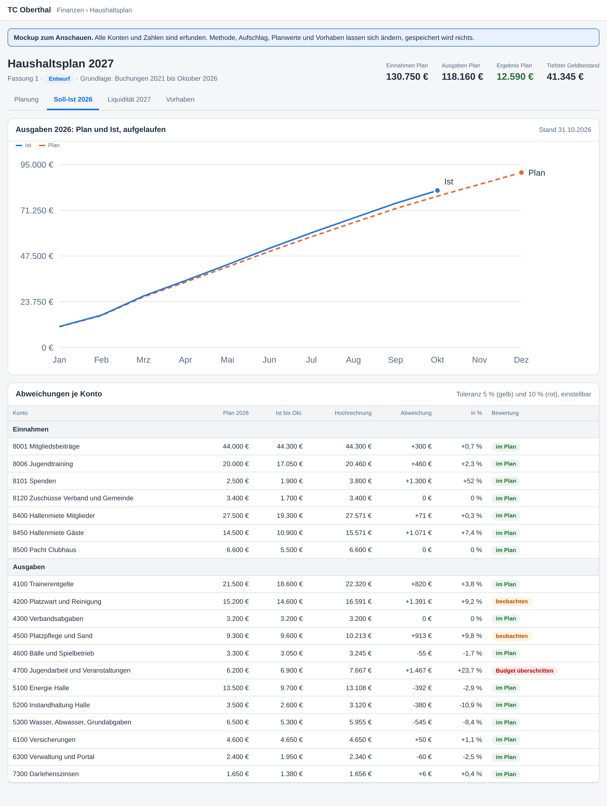
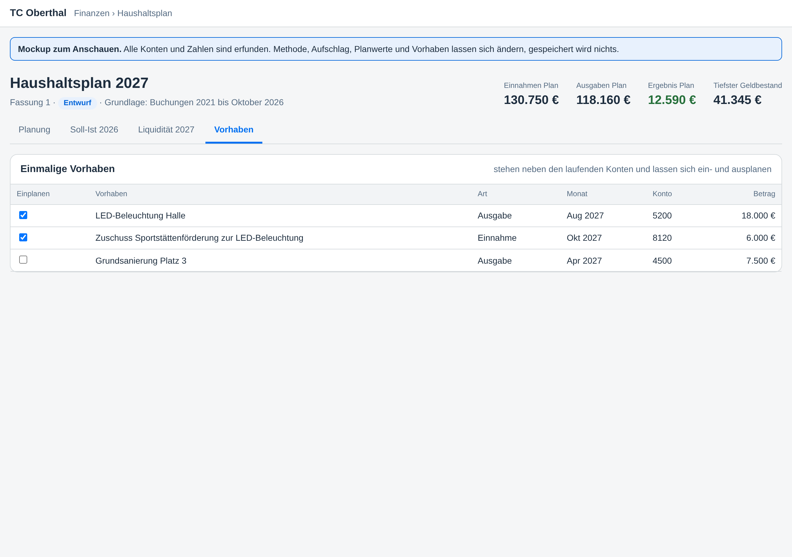

# Haushaltsplan – Konzept (Stand 15.11.2026)

Dieses Dokument beschreibt, wie ein Haushaltsplan (Budget je Konto mit Soll-Ist-Vergleich) in das Vereinsportal passt.
**Umgesetzt** als App *Finanzen → Haushaltsplan* – was genau, steht in Abschnitt 9 „Umsetzungsstand“. Das klickbare Mockup mit erfundenen Zahlen war die Vorlage:
[`mockup.html`](mockup.html) (Datei herunterladen und im Browser öffnen), Bildschirmfotos stehen unten.

## 1 Ziel

Der Vorstand legt im Herbst fest, mit welchen Einnahmen und Ausgaben er im Folgejahr rechnet, lässt den Plan beschließen und
sieht während des Jahres, wo der Verein davon abweicht. Heute zeigt das Portal nur, was war (Einnahmen & Ausgaben,
Jahresabschluss) und was an Beiträgen zu erwarten ist (Beitragsforecast). Ein Planwert je Konto fehlt.

Leitgedanke: **Der Plan entsteht als Vorschlag aus den vorhandenen Buchungen** und wird nur dort von Hand geändert, wo der
Vorstand es besser weiß. Niemand soll 30 Konten aus dem Kopf füllen müssen.

## 2 Worauf der Plan aufbaut

| Vorhandene Daten | Wo | Verwendung im Haushaltsplan |
|---|---|---|
| Buchungen je Konto, Jahr und Monat | `tco.fibuchungen` (Soll/Haben, auch die aus SAP übernommenen Jahre) | Ist-Werte der Vorjahre, Jahresverlauf je Konto, Ist im laufenden Jahr |
| Kontenstamm mit Kennzahl und Verrechnungskonto | `tco.fikonten` | Gliederung nach Tätigkeitsbereich A–D wie im Jahresabschluss; Verdichtung (z. B. Gas/Wasser/Strom) |
| Kontenverwendung je Geschäftsjahr | `tco.fikontojahr` | nur aktive Konten werden geplant |
| Einnahme/Ausgabe/Geldkonto | `kontoart()` in `finanz/logik.ts` | dieselbe Abgrenzung wie in „Einnahmen & Ausgaben“, damit Plan und Ist zusammenpassen |
| Laufende Verträge und Beitragsstamm | Beitragsforecast (`forecast/logik.ts`) | Planwert für Mitgliedsbeiträge und Jugendtraining aus den Verträgen statt aus der Vergangenheit |
| Geldbestände, Darlehen | `geldkonten()`, `kreditkonten()` | Anfangsbestand und Tilgung der Liquiditätsvorschau |
| Anlagen mit AfA | `tco.anlagen` | nur zur Information, AfA ist keine Zahlung |
| Projekte | `tco.fibuchungen.projekt`, `tco.projekte` | einmalige Vorhaben vom laufenden Betrieb trennen |

Die Jahreswerte werden mit denselben Funktionen gebildet wie im Jahresabschluss (`jahreswerteLesen`: Verrechnungskonten
verdichtet, Sonderregel Konto 8012, Jahr ersatzweise aus dem Buchungsdatum). So stimmt „Ist 2025“ im Haushaltsplan mit dem
beschlossenen Abschluss überein.

## 3 Wie der Vorschlag entsteht

Je Konto stehen mehrere Methoden zur Wahl:

| Methode | Rechnung | passt für |
|---|---|---|
| Hochrechnung laufendes Jahr | Ist bis zum letzten gebuchten Monat ÷ üblicher Anteil dieser Monate am Jahr | Konten mit stabiler Höhe |
| Durchschnitt 3 Jahre | Mittel der letzten drei Jahre | schwankende Konten ohne Richtung |
| Median 5 Jahre | mittlerer Wert der letzten fünf Jahre | Konten mit einzelnen Ausreißern |
| Trend | lineare Fortschreibung der letzten fünf Jahre | Konten, die stetig steigen oder fallen |
| Fachdaten | Beitragsforecast aus den Verträgen | Mitgliedsbeiträge, Jugendtraining |
| Manuell | Eingabe | neue Konten, bewusste Entscheidungen |

Damit der Vorschlag die Vergangenheit bestmöglich nutzt, kommen vier Bausteine dazu:

1. **Rückwirkende Prüfung (Treffsicherheit).** Jede Methode wird auf die Vergangenheit angewendet: Was hätte sie mit den Daten
   bis 2024 für 2025 vorhergesagt, und wie weit lag das vom Ist entfernt? Je Konto ist die Methode mit der kleinsten Abweichung
   vorbelegt, die Trefferquote steht daneben. Bei genügend Jahren wird über mehrere Prüfjahre gemittelt.
2. **Sondereffekte.** Einzelne Jahre eines Kontos lassen sich mit Begründung aus der Grundlage nehmen (z. B. Dachsanierung,
   Spendenaktion). Das Portal schlägt Ausreißer vor (Abweichung vom Median über einer einstellbaren Schwelle), entscheiden muss
   der Kassenwart.
3. **Laufendes Jahr.** Geplant wird im Herbst, das Jahr ist dann nicht abgeschlossen. Das Ist wird mit dem **Jahresverlauf des
   Kontos** hochgerechnet: Anteil jedes Monats am Jahr, gemittelt über die Vorjahre. Energie fällt im Winter an, Beiträge im
   Januar und Juli, Platzpflege im Frühjahr; eine einfache Rechnung „mal zwölf durch zehn“ läge hier daneben.
4. **Preissteigerung.** Ein Zuschlag in Prozent auf Ausgaben, gesamt oder je Konto.

Derselbe Jahresverlauf verteilt den Planwert auf die Monate. Daraus entsteht die **Liquiditätsvorschau**: Geldbestand je
Monatsende mit Tilgung und Vorhaben, verglichen mit einer einstellbaren Mindestreserve.

Grenzen, die das Portal anzeigt statt verschweigt:

- Konten mit weniger als drei Jahren Historie bekommen keinen Trend und keine Trefferquote.
- Wechselt ein Konto seine Bedeutung oder wird es aufgeteilt, lässt sich ein Vorgängerkonto zuordnen; ohne Zuordnung gilt die Historie nicht.
- Umbuchungen zwischen Geldkonten, Bestandskonten (Kennzahl BA) und Darlehen (BK) sind keine Einnahmen oder Ausgaben; Tilgung erscheint nur in der Liquidität.
- Stornos heben sich im Jahreswert auf, im Monatsverlauf zählen sie im Monat der Stornobuchung.

## 4 Ablauf

1. **Plan anlegen** für ein Geschäftsjahr: Das Portal füllt alle aktiven Konten mit dem Vorschlag.
2. **Bearbeiten:** Methode wechseln, Planwert überschreiben, Notiz je Konto, einmalige Vorhaben erfassen.
3. **Vorlegen und beschließen:** Entwurf → vom Vorstand beschlossen → von der Mitgliederversammlung genehmigt. Ein beschlossener
   Plan ist unveränderlich; Änderungen im Jahr laufen als **Nachtrag** (neue Fassung mit Begründung), die alte bleibt sichtbar.
4. **Soll-Ist im laufenden Jahr:** je Konto Plan, Ist, Hochrechnung zum Jahresende und Abweichung mit Bewertung nach
   einstellbarer Toleranz. Überschreitungen erscheinen im Arbeitsvorrat des Kassenwarts und als Kennzahl auf der Startseite.
5. **Ausgabe:** PDF für die Mitgliederversammlung, gegliedert nach Tätigkeitsbereichen mit zwei Vorjahren (wie der
   Jahresabschluss), Ablage in Paperless, Bausteine für die Präsentation.

## 5 Mockup

Die vier Reiter des Mockups (erfundene Konten und Zahlen):

**Planung** – Vorjahre, Hochrechnung, Methode mit Trefferquote, Vorschlag und überschreibbarer Planwert:

**Soll-Ist** – aufgelaufene Ausgaben gegen den Plan und Abweichungen je Konto:

**Liquidität** – Geldbestand je Monatsende gegen die Mindestreserve:

**Vorhaben** – einmalige Investitionen und Zuschüsse, ein- und ausplanbar:

## 6 Technischer Entwurf

Neue Tabellen im Schema `tco` (alle mit Änderungsbelegen):

| Tabelle | Inhalt |
|---|---|
| `hh_plan` | Geschäftsjahr, Fassung, Status (Entwurf / beschlossen / genehmigt), Beschlussdatum, Preissteigerung, Mindestreserve |
| `hh_position` | Plan, Konto, Methode, Vorschlag, Planwert, Zuschlag, Notiz, „von Hand geändert“ |
| `hh_monat` | Plan, Konto, Monat, Betrag (nur wenn der Monatsverlauf von Hand geändert wurde, sonst berechnet) |
| `hh_sondereffekt` | Konto, Jahr, Grund – Jahre, die nicht in die Grundlage zählen |
| `hh_vorhaben` | Plan, Bezeichnung, Einnahme/Ausgabe, Monat, Betrag, Konto, Projekt, eingeplant ja/nein |
| `hh_konto_vorgaenger` | Konto, Vorgängerkonto, ab Jahr |

- Code: `modules/tco/server/haushalt/` (reine Rechenfunktionen `vorschlag.ts` mit Tests, `logik.ts`, `routes.ts`, `pdf.ts`),
  Oberfläche `modules/tco/web/haushalt/` mit den vorhandenen Bausteinen (`AppPage`, `Section`, `ObjectStatus`, SVG-Diagramme).
- Rechte: `tco.haushalt:display` (ansehen), `:edit` (planen), `:admin` (beschließen, Nachtrag, Einstellungen). Funktionsschalter
  für die App; Einstellungen (Toleranzen, Mindestreserve, Ausreißerschwelle) unter Administration → Einstellungen → TC Oberthal.
- Es wird nur gelesen, was schon da ist; an FI-Belegen ändert der Haushaltsplan nichts.

## 7 Umsetzung in Stufen

| Stufe | Inhalt | Ergebnis |
|---|---|---|
| 1 | Plan je Konto mit Vorschlag (alle Methoden, Hochrechnung, Sondereffekte), Fassungen und Status, Soll-Ist-Tabelle | Der Plan 2027 lässt sich erstellen und verfolgen |
| 2 | Monatsverteilung, Liquiditätsvorschau, Vorhaben, PDF mit Ablage in Paperless | Vorlage für die Mitgliederversammlung |
| 3 | Rückwirkende Prüfung über mehrere Jahre, Arbeitsvorrat und Kennzahl, Präsentationsbausteine, Nachtrag | Überwachung im laufenden Jahr |

## 8 Offene Fragen an den Vorstand

1. Wird je Konto geplant oder reicht eine gröbere Ebene (Kontengruppen bzw. Tätigkeitsbereiche)?
2. Wer beschließt verbindlich: Vorstand allein oder die Mitgliederversammlung (laut Satzung)?
3. Welche Toleranz gilt als Abweichung (Vorschlag 5 % beobachten, 10 % überschritten) und welche Mindestreserve?
4. Sollen Überschreitungen nur angezeigt werden, oder soll das Portal beim Buchen auf ein ausgeschöpftes Budget hinweisen?
5. Ab welchem Jahr sind die aus SAP übernommenen Buchungen vollständig genug, um als Grundlage zu dienen?

## 9 Umsetzungsstand (16.11.2026)

Alle drei Stufen aus Abschnitt 7 sind umgesetzt: App *Finanzen → Haushaltsplan* (`/tco/haushalt`), Migration
`088_haushaltsplan.sql`, Code `modules/tco/server/haushalt` (`vorschlag.ts` Rechenkern, `logik.ts`, `routes.ts`, `pdf.ts`) und
`modules/tco/web/haushalt`, Tests `server/test/tco_haushalt_vorschlag.test.ts` (Rechenkern) und `server/test/tco_haushalt.test.ts`.

### Entscheidungen zu den offenen Fragen (Abschnitt 8)

Sie gelten, bis der Vorstand anderes sagt; was eine Einstellung ist, steht unter *Administration → Einstellungen → TC Oberthal → Haushaltsplan*.

| Frage | Entscheidung |
|---|---|
| 1 Ebene | Geplant wird je Konto; die Anzeige gruppiert nach Einnahmen/Ausgaben und Tätigkeitsbereich (Kennzahl A–D) mit Zwischensummen. |
| 2 Beschluss | Entwurf → vom Vorstand beschlossen → von der Mitgliederversammlung genehmigt; „genehmigt“ ist optional (Einstellung, ob der Schritt angeboten wird). Ab „beschlossen“ unveränderlich, Änderungen nur als Nachtrag. |
| 3 Toleranz | 5 % beobachten, 10 % überschritten (Einstellung). Mindestreserve: Vorgabe leer = der Geldbestand wird nicht bewertet. Ausreißerschwelle 50 % Abweichung vom Median (Einstellung). |
| 4 Überschreitung | Nur Anzeige: App, Arbeitsvorrat des Kassenwarts, Kennzahl der Kachel. Kein Eingriff in die FI-Buchung. |
| 5 Grundlage | Einstellung „Grundlage ab Jahr“; Vorgabe leer = alle vorhandenen Jahre, höchstens die letzten sechs abgeschlossenen vor dem Basisjahr. |

### Was umgesetzt ist

- **Ist-Werte** wie im Jahresabschluss: `monatswerteLesen` bildet je Konto, Jahr und Monat dieselben Werte wie `jahreswerteLesen`
  (Verrechnungskonten verdichtet, Konto 8012 nur Haben, Jahr ersatzweise aus dem Datum); ein Test vergleicht „Ist Vorjahr“ je Konto
  mit der bestehenden Funktion. Die Kontoart kommt aus `kontoart()`. Ein Storno zählt im Monat der Stornobuchung.
- **Methoden** Hochrechnung, Durchschnitt 3 Jahre, Median 5 Jahre, Trend, Fachdaten, Manuell. Das laufende Jahr geht hochgerechnet
  als jüngster Wert in Durchschnitt, Median und Trend ein.
- **Hochrechnung** über den Jahresverlauf des Kontos (Monatsanteile, über die Vorjahre gemittelt). „Gebucht“ ist das laufende Jahr bis
  zum letzten abgelaufenen Monat, der auch Buchungen hat – ein halb gebuchter Monat zählt nicht.
- **Rückwirkende Prüfung** über bis zu drei Jahre: Jede Methode bekommt die Daten, die zum selben Zeitpunkt des Vorjahres vorlagen
  (im Herbst also das hochgerechnete Vorjahr, nicht dessen späteren Endwert). Verglichen wird über dieselben Jahre.
- **Sondereffekte** je Konto und Jahr mit Pflicht-Begründung, Ausreißer als Vorschlag; **Vorgängerkonto** mit „ab Jahr“;
  **Preissteigerung** je Plan und je Konto.
- **Fachdaten:** Die Beitragsart zeigt über `tco.beitrag.erloeskonto` auf ihr Erlöskonto (dasselbe Konto, auf das die Sollstellung bucht).
  Fachdaten gibt es nur, wo das eindeutig ist – siehe Abweichungen.
- **Fassungen und Status**, Nachtrag mit Begründung, Löschen nur im Entwurf; Unveränderlichkeit zusätzlich per Datenbank-Trigger.
- **Monatsverteilung** (berechnet oder je Konto von Hand), **Liquiditätsvorschau**, **einmalige Vorhaben**, **PDF** mit Ablage in Paperless.
- **Soll-Ist** mit Hochrechnung, Bewertung und Diagramm; **Arbeitsvorrat und Kennzahl**; **Präsentationsbausteine** `HH_PLAN`, `HH_SOLLIST`, `HH_LIQ`.

### Abweichungen vom Konzept

- **Einstellungen** stehen in einer eigenen Tabelle `tco.hh_cfg` (im Entwurf nicht genannt). Die Mindestreserve gibt es als Einstellung
  und zusätzlich je Plan; Toleranzen gelten für alle Pläne.
- **`hh_monat`** hält nicht nur von Hand geänderte Monate: Mit dem Beschluss wird der berechnete Verlauf festgeschrieben
  (Spalte `von_hand` unterscheidet). Sonst würde sich eine beschlossene Fassung mit jeder neuen Buchung verschieben.
- **`hh_sondereffekt` und `hh_konto_vorgaenger`** gelten für alle Pläne, nicht je Plan. Ein Sondereffekt ändert einen Entwurf erst mit
  „Vorschlag neu berechnen“, eine beschlossene Fassung nie.
- **Hochrechnung bei kleinem Anteil:** Sind bis zum Stand üblicherweise weniger als 15 % des Jahres angefallen (Spenden im Dezember,
  Verbandsabgabe im März), wird nicht durch den Anteil geteilt, sondern „Ist + üblicher Rest“ gerechnet (Mittel der letzten drei Jahre
  × fehlender Anteil). Ohne Vorjahre wird gleichmäßig hochgerechnet und das Konto als „wenig Historie“ gekennzeichnet.
- **Trend im Herbst:** Der Trend braucht drei abgeschlossene Jahre vor dem laufenden. Dadurch reicht die rückwirkende Prüfung mit
  sechs Jahren Historie über zwei statt drei Jahre – verglichen wird nur über Jahre, in denen alle Methoden rechnen können.
- **Fachdaten nur bei eindeutiger Zuordnung:** Zeigt auch eine aktive Beitragsart auf das Konto, die der Beitragsforecast nicht
  rechnet, oder ist das Konto zugleich Erlöskonto eines Produkts, bleibt es bei den Methoden aus der Vergangenheit; der Grund steht
  unter „So entsteht der Vorschlag“. Der Forecast rechnet Sollstellungen, FI bucht Zahlungen – beides kann zeitlich auseinanderliegen.
- **Kontoart nach Nummernbereich:** Konten mit Kennzahl A–D außerhalb von 2001–7999 und 8001–8999 sind nach `kontoart()` weder
  Einnahme noch Ausgabe und stehen nicht im Plan; die App nennt sie als Hinweis. Konto 8012 zählt wie im Jahresabschluss nur mit
  der Haben-Seite (die App „Einnahmen und Ausgaben“ rechnet dort Haben − Soll).
- **Tilgung:** Vorschlag aus der Bewegung der Darlehenskonten (Kennzahl BK) der letzten zwölf bekannten Monate, überschreibbar am
  Plan. Wurde in dieser Zeit ein Darlehen aufgenommen, weist die App darauf hin.
- **Anfangsbestand der Liquidität:** für das Folgejahr der Geldbestand zum letzten gebuchten Monat plus das hochgerechnete
  Restergebnis des laufenden Jahres minus Tilgung; überschreibbar am Plan.
- **Vorschläge sind auf 10 € gerundet** (wie im Mockup); von Hand eingegebene Planwerte bleiben, wie sie sind.
- **Arbeitsvorrat:** Einträge entstehen nur für überschrittene *Ausgaben*budgets einer *beschlossenen* Fassung des laufenden Jahres.
  Einnahmen unter Plan stehen im Soll-Ist, sind aber keine Aufgabe.
- **Projekte:** Das Feld „Projekt“ am Vorhaben ist ein freier Text. Planung, Genehmigung und Simulation von Projekten stehen in
  Abschnitt 10.
- **AfA** wird nicht angezeigt (im Konzept „nur zur Information“).

### Nicht geprüft

Die Ablage in Paperless ist nach dem Muster des Jahresabschlusses gebaut, aber nicht gegen ein echtes Paperless gelaufen
(im Test nur die Abweisung ohne eingerichtetes Paperless).

## 10 Projekte: Planung, Genehmigung und Simulation (16.11.2026)

Wunsch des Vereins nach der Freigabe des Konzepts: „Spannend wäre die Planung und Genehmigung sowie Einbeziehen von Projekten,
die Einfluss auf den Haushaltsplan hätten. Ihre Zeitspanne und Kosten sollen ebenfalls mit in den Haushaltsplan reinsimuliert
werden können.“ Umgesetzt als Reiter **Projekte** der App Haushaltsplan (Migration `089_haushalt_projekte.sql`, Rechenkern
`modules/tco/server/haushalt/projekt.ts`, Abläufe `projekte.ts`, Oberfläche `modules/tco/web/haushalt/Projekte.tsx`,
Test `server/test/tco_haushalt_projekt.test.ts`).

### Was ein Projekt ist

| Angabe | Inhalt |
|---|---|
| Kopf | Bezeichnung, Beschreibung, Verantwortlicher, Tätigkeitsbereich, **Zeitspanne** Beginn/Ende als Monat – auch über mehrere Geschäftsjahre |
| Projektnummer | die Nummer, unter der in FI gebucht wird (`tco.fibuchungen.projekt`, Stamm `tco.projekte`) – keine zweite Nummer; ohne sie gibt es kein Ist |
| Positionen | Kosten · Zuschuss · Spende · Eigenmittel · Darlehen (Zufluss) · Tilgung des Darlehens · Folgekosten (jährlich) · Einsparung (jährlich), je mit Betrag und – wo es Einnahme oder Ausgabe ist – Konto |
| Verteilung | gleichmäßig über die Laufzeit (oder einen eigenen Zeitraum der Position) · in einem Monat · von Hand je Monat · jährlich wiederkehrend (Folgekosten/Einsparung; ohne Angabe ab dem Monat nach dem Projektende, unbefristet) |

Wirkung im Haushaltsplan: Kosten und Folgekosten sind Ausgaben, Einsparungen mindern die Ausgaben, Zuschuss und Spende sind
Einnahmen. **Darlehen und Tilgung berühren das Ergebnis nicht** – der Zufluss und die Tilgung stehen nur in der Liquidität.
Eigenmittel sind der Teil, den der Verein aus dem Geldbestand trägt; sie zeigen, ob die Finanzierung aufgeht (Lücke = Kosten −
Finanzierung), wirken aber nicht gesondert.

### Genehmigung

Idee/Entwurf → beantragt → vom Vorstand genehmigt | abgelehnt | zurückgestellt → in Umsetzung → abgeschlossen. Jeder Schritt hält
Datum, Benutzer und Begründung fest (Verlauf am Projekt, dazu Änderungsbelege); Ablehnen und Zurückstellen verlangen eine
Begründung, ein Antrag mindestens eine Kostenposition.

- Planen und beantragen: `tco.haushalt:edit`. **Entscheiden: eigenes Recht `tco.projekte:approve`** (Aktivität `approve` laut
  `docs/berechtigungskonzept.md`; setzt nur `tco.haushalt:display` voraus, damit ein Vorstandsmitglied entscheiden kann, ohne zu planen).
- Der Antrag erscheint im Arbeitsvorrat (Bereich Vorstand) bei allen, die genehmigen dürfen.
- Ab „beantragt“ ändert ein Projekt nur noch, wer genehmigen darf – ein genehmigtes Budget lässt sich nicht still verändern.
  Löschen geht nur für Ideen und Abgelehntes und nie, wenn das Projekt in einem beschlossenen Plan festgehalten ist.

### Simulation im Plan

- Im Reiter Projekte steht je Projekt, das im Planjahr wirkt, **einrechnen ja/nein**. Vorgabe nach dem Status: genehmigt, in
  Umsetzung und abgeschlossen (wegen der Folgekosten) ja – Idee, beantragt, zurückgestellt, abgelehnt nein. Die Wahl gilt je
  Plan-Fassung und lässt sich im Entwurf jederzeit ändern („probeweise eingerechnet“).
- Eingerechnete Projekte wirken mit ihren Monatswerten auf Einnahmen, Ausgaben, Ergebnis und Geldbestand je Monatsende.
  **Mehrjährige Projekte wirken anteilig** in jedem betroffenen Jahr – auch in späteren Plänen, ohne dass man sie dort neu erfasst.
- Sichtbar ist die Auswirkung an drei Stellen: Tabelle „ohne Projekte / mit den gewählten Projekten / Unterschied“ (Einnahmen,
  Ausgaben, Ergebnis, Geldbestand 31.12., tiefster Geldbestand), je Projekt sein **Beitrag** (was sich ändert, wenn genau dieses
  Projekt ein- oder ausgerechnet wird) und in den Kennzahlen im Kopf („ohne Projekte …“). Die Planung zeigt eine Zeile „Projekte“.
- **Mit dem Beschluss** wird festgeschrieben, welche Projekte mit welchen Werten eingerechnet waren (`hh_plan_projekt.fest`).
  Wird ein Projekt später teurer oder genehmigt, ändert das die beschlossene Fassung nicht – erst ein Nachtrag rechnet wieder mit
  dem aktuellen Stand; er übernimmt die Auswahl der Vorfassung.

### Soll-Ist und Doppelzählung

- **Je Projekt:** Ist-Kosten aus den FI-Buchungen mit der Projektnummer (Ausgabekonten Soll − Haben, Einnahmekonten Haben − Soll)
  gegen das Projektbudget über die ganze Laufzeit, bewertet mit denselben Toleranzen wie ein Konto; dazu der Anteil des Jahres.
  Ein überschrittenes Projektbudget steht im Arbeitsvorrat des Kassenwarts.
- **Im Konto:** Projektbuchungen werden aus dem Ist des Kontos herausgerechnet und daneben als „auf Projekte gebucht“ gezeigt. Eine
  Hallensanierung über das Instandhaltungskonto meldet also nicht zusätzlich „Budget überschritten“ für das Konto.
- **In der Grundlage:** Projektbuchungen zählen wie ein Sondereffekt nicht in Durchschnitt, Median, Trend, Hochrechnung und
  Jahresverlauf. Die Spalten „Ist“ der Planung zeigen weiter den vollen Jahreswert wie im Jahresabschluss.
- Als Projektbuchung gilt, was die Projektnummer eines Projekts des Haushaltsplans trägt. Buchungen mit einer Nummer, zu der es
  hier kein Projekt gibt, bleiben laufender Betrieb.

### Entscheidungen und Grenzen

- Die **einmaligen Vorhaben** bleiben als einfache Einmalposten ohne Genehmigung bestehen (kleine Dinge, die keinen Antrag
  brauchen); größere Vorhaben mit Zeitspanne und Finanzierung gehören in die Projekte. Eine Umwandlung Vorhaben → Projekt gibt es nicht.
- Das Portal setzt die Projektnummer nicht selbst an FI-Buchungen – sie kommt heute aus der SAP-Übernahme. Bis FI im Portal eine
  Projektnummer erfassen lässt, gibt es für neue Projekte kein Ist; die Planung und Simulation braucht es nicht.
- Wer planen **und** genehmigen darf, kann einen eigenen Antrag genehmigen; das Portal verhindert es nicht (kleiner Verein),
  der Verlauf zeigt beide Schritte mit Namen.
- Die Tilgung eines Projektdarlehens ist eine Position des Projekts. Sobald das Darlehen in FI gebucht ist, erscheint seine Tilgung
  zusätzlich im Vorschlag aus den Darlehenskonten (Kennzahl BK) – dann das Projekt abschließen oder die Tilgungsposition beenden.
- Ein Projekt in einem beschlossenen Plan wirkt im Soll-Ist der Konten nicht als Planwert des Kontos; Plan und Ist des Projekts
  stehen in der eigenen Tabelle.
