<!-- Automatisch erzeugt von scripts/landschaft.mjs – nicht von Hand ändern. Quelle der Prozesse: docs/landschaft/prozesse.json -->
# Level 2 – Prozesslandschaft

Kernprozesse von Ende zu Ende. Jeder Verweis ist gegen den Code geprüft (⚠️ = nicht gefunden).

| ID | Prozess | Bereich | Auslöser | Ergebnis | Schritte |
|---|---|---|---|---|---|
| P1 | [Mitglied werden](#p1) | Mitglieder | Online-Antrag oder Schnuppertraining | aktives Mitglied mit Vertrag, SEPA-Mandat und Portalzugang | 7 |
| P2 | [Beiträge einziehen](#p2) | Finanzen | Sollmonat (Turnus der Verträge) | Beiträge auf den Erlöskonten gebucht | 7 |
| P3 | [Halle buchen und abrechnen](#p3) | Tennishalle | Buchung im Portal oder in EP3 | bezahlte Hallenrechnung, Beleg in Paperless | 6 |
| P4 | [Jugendtraining abrechnen](#p4) | Jugend | Monatsende | Zeitnachweis in Paperless, Trainerentgelt bezahlt | 6 |
| P5 | [Clubhaus und Verzehr](#p5) | Clubhaus | Verzehr an der Theke | Sammelabrechnung je Mitglied, Zahlung gebucht | 6 |
| P6 | [Dokumenteneingang](#p6) | Dokumente | E-Mail im Postfach (alle 5 Minuten) | Dokument abgelegt und qualifiziert, Mail behandelt | 7 |
| P7 | [Vereinsleben (Kalender)](#p7) | Mitglieder | Spielplan oder Veranstaltung | Termine mit Rückmeldungen je Gruppe | 5 |
| P8 | [Abschluss und Steuerung](#p8) | Finanzen | Monats- und Jahresende | Jahresabschluss in Paperless, Kennzahlen aktuell | 5 |
| P9 | [Schäden melden und beheben](#p9) | Instandhaltung | Mitglied entdeckt einen Schaden (QR-Code an der Anlage) | Schaden behoben, Platz wieder freigegeben, Melder informiert | 9 |
| P10 | [Hallenschlüssel ausgeben und zurücknehmen](#p10) | Tennishalle | Mitglied oder Kunde braucht einen Hallenschlüssel | Schlüssel dokumentiert, quittiert, Pfand berechnet bzw. gutgeschrieben, Belege in Paperless | 6 |

## P1 · Mitglied werden

**Auslöser:** Online-Antrag oder Schnuppertraining · **Ergebnis:** aktives Mitglied mit Vertrag, SEPA-Mandat und Portalzugang

```mermaid
flowchart LR
  S0["Schnuppertraining anmelden (optional)<br/><small>Öffentlichkeit (ohne Anmeldung) · Vereinsportal (Modul tco)</small>"]:::portal
  S1["Trainer betreut, Beitrittslink senden<br/><small>Trainer · Vereinsportal (Modul tco)</small>"]:::portal
  S0 --> S1
  S2["Online-Antrag mit SEPA-Mandat<br/><small>Öffentlichkeit (ohne Anmeldung) · Vereinsportal (Modul tco)</small>"]:::portal
  S1 --> S2
  S3["Eingangsbestätigung per Mail<br/><small>System / zeitgesteuerter Job · n8n-Workflow</small>"]:::n8n
  S2 --> S3
  S4["Prüfen (Dubletten) und übernehmen<br/><small>Kassenwart · Vereinsportal (Modul tco)</small>"]:::portal
  S3 --> S4
  S5["Gruppen per Regelwerk zuordnen<br/><small>System / zeitgesteuerter Job · Vereinsportal (Modul tco)</small>"]:::portal
  S4 --> S5
  S6["Einladung annehmen, eigene Daten pflegen<br/><small>Mitglied · Vereinsportal (Modul tco)</small>"]:::portal
  S5 --> S6
  classDef portal fill:#ffffff,stroke:#1f5fa8,stroke-width:2px,color:#1f5fa8
  classDef n8n fill:#ffffff,stroke:#2e7d32,stroke-width:2px,color:#2e7d32
  classDef extern fill:#ffffff,stroke:#2a9d8f,stroke-width:2px,color:#1d6f66
  classDef person fill:#ffffff,stroke:#7f7f7f,stroke-width:2px,stroke-dasharray:4 3,color:#404040
```

| # | Schritt | Akteur | System | Route | Recht | App | Workflow |
|---|---|---|---|---|---|---|---|
| 1 | Schnuppertraining anmelden (optional) | Öffentlichkeit (ohne Anmeldung) | Vereinsportal (Modul tco) | `POST /api/m/tco/schnupper` |  | `/schnuppertraining` |  |
| 2 | Trainer betreut, Beitrittslink senden | Trainer | Vereinsportal (Modul tco) | `POST /api/m/tco/schnuppertraining/:adrnr/beitrittslink` | `tco.schnupper:edit` | `/tco/schnuppertraining` |  |
| 3 | Online-Antrag mit SEPA-Mandat | Öffentlichkeit (ohne Anmeldung) | Vereinsportal (Modul tco) | `POST /api/m/tco/antrag` |  | `/beitritt` |  |
| 4 | Eingangsbestätigung per Mail | System / zeitgesteuerter Job | n8n-Workflow |  |  |  | TCO Mailversand |
| 5 | Prüfen (Dubletten) und übernehmen | Kassenwart | Vereinsportal (Modul tco) | `POST /api/m/tco/mitgliedsantraege/:id/uebernehmen` | `tco.antraege:edit` | `/tco/mitgliedsantraege` |  |
| 6 | Gruppen per Regelwerk zuordnen | System / zeitgesteuerter Job | Vereinsportal (Modul tco) | `POST /api/m/tco/gruppen/regeln/anwenden` | `tco.gruppen:edit` | `/tco/gruppen` |  |
| 7 | Einladung annehmen, eigene Daten pflegen | Mitglied | Vereinsportal (Modul tco) | `POST /api/m/tco/einladung` | `tco.meinedaten:edit` | `/tco/meine-mitgliedschaft` |  |

## P2 · Beiträge einziehen

**Auslöser:** Sollmonat (Turnus der Verträge) · **Ergebnis:** Beiträge auf den Erlöskonten gebucht

```mermaid
flowchart LR
  S0["Beitragsstamm pflegen<br/><small>Kassenwart · Vereinsportal (Modul tco)</small>"]:::portal
  S1["Vorschlag je Sollmonat<br/><small>Kassenwart · Vereinsportal (Modul tco)</small>"]:::portal
  S0 --> S1
  S2["Lauf erzeugen: SEPA pain.008<br/><small>Kassenwart · Vereinsportal (Modul tco)</small>"]:::portal
  S1 --> S2
  S3["PDF-Protokoll nach Paperless<br/><small>Kassenwart · Paperless-ngx</small>"]:::extern
  S2 --> S3
  S4["Datei bei der Bank einreichen<br/><small>Kassenwart · Bank (Dateiaustausch)</small>"]:::extern
  S3 --> S4
  S5["Bankimport: Sammelgutschrift splitten<br/><small>Kassenwart · Vereinsportal (Modul tco)</small>"]:::portal
  S4 --> S5
  S6["Buchen auf Erlöskonten<br/><small>Kassenwart · Vereinsportal (Modul tco)</small>"]:::portal
  S5 --> S6
  classDef portal fill:#ffffff,stroke:#1f5fa8,stroke-width:2px,color:#1f5fa8
  classDef n8n fill:#ffffff,stroke:#2e7d32,stroke-width:2px,color:#2e7d32
  classDef extern fill:#ffffff,stroke:#2a9d8f,stroke-width:2px,color:#1d6f66
  classDef person fill:#ffffff,stroke:#7f7f7f,stroke-width:2px,stroke-dasharray:4 3,color:#404040
```

| # | Schritt | Akteur | System | Route | Recht | App | Workflow |
|---|---|---|---|---|---|---|---|
| 1 | Beitragsstamm pflegen | Kassenwart | Vereinsportal (Modul tco) | `POST /api/m/tco/beitraege` | `tco.beitraege:edit` | `/tco/beitraege` |  |
| 2 | Vorschlag je Sollmonat | Kassenwart | Vereinsportal (Modul tco) | `POST /api/m/tco/soll/vorschlag` | `tco.soll:edit` | `/tco/sollstellung` |  |
| 3 | Lauf erzeugen: SEPA pain.008 | Kassenwart | Vereinsportal (Modul tco) | `POST /api/m/tco/soll/laeufe` | `tco.soll:edit` |  |  |
| 4 | PDF-Protokoll nach Paperless | Kassenwart | Paperless-ngx | `POST /api/m/tco/soll/laeufe/:id/paperless` |  |  |  |
| 5 | Datei bei der Bank einreichen | Kassenwart | Bank (Dateiaustausch) |  |  |  |  |
| 6 | Bankimport: Sammelgutschrift splitten | Kassenwart | Vereinsportal (Modul tco) | `POST /api/m/tco/fi/bank/lesen` | `tco.fi:buchen` | `/tco/fi` |  |
| 7 | Buchen auf Erlöskonten | Kassenwart | Vereinsportal (Modul tco) | `POST /api/m/tco/fi/buchen` | `tco.fi:buchen` |  |  |

## P3 · Halle buchen und abrechnen

**Auslöser:** Buchung im Portal oder in EP3 · **Ergebnis:** bezahlte Hallenrechnung, Beleg in Paperless

```mermaid
flowchart LR
  S0["Platz buchen<br/><small>Hallennutzer · Vereinsportal (Modul tco)</small>"]:::portal
  S1["EP3-Buchungen und Kunden holen<br/><small>Kassenwart · n8n-Workflow</small>"]:::n8n
  S0 --> S1
  S2["Preisfindung und Zuordnung<br/><small>Kassenwart · Vereinsportal (Modul tco)</small>"]:::portal
  S1 --> S2
  S3["Rechnung als PDF mit GiroCode<br/><small>Kassenwart · Vereinsportal (Modul tco)</small>"]:::portal
  S2 --> S3
  S4["Sammelversand per Mail<br/><small>Kassenwart · n8n-Workflow</small>"]:::n8n
  S3 --> S4
  S5["Zahlung zuordnen (Split je Erlöskonto)<br/><small>Kassenwart · Vereinsportal (Modul tco)</small>"]:::portal
  S4 --> S5
  classDef portal fill:#ffffff,stroke:#1f5fa8,stroke-width:2px,color:#1f5fa8
  classDef n8n fill:#ffffff,stroke:#2e7d32,stroke-width:2px,color:#2e7d32
  classDef extern fill:#ffffff,stroke:#2a9d8f,stroke-width:2px,color:#1d6f66
  classDef person fill:#ffffff,stroke:#7f7f7f,stroke-width:2px,stroke-dasharray:4 3,color:#404040
```

| # | Schritt | Akteur | System | Route | Recht | App | Workflow |
|---|---|---|---|---|---|---|---|
| 1 | Platz buchen | Hallennutzer | Vereinsportal (Modul tco) | `POST /api/m/tco/platz/buchungen` | `tco.platzbuchung:edit` | `/tco/platz-buchen` |  |
| 2 | EP3-Buchungen und Kunden holen | Kassenwart | n8n-Workflow | `POST /api/m/tco/halle/import/n8n` | `tco.halle:edit` |  | TCO EP3 Import Portal |
| 3 | Preisfindung und Zuordnung | Kassenwart | Vereinsportal (Modul tco) | `POST /api/m/tco/halle/zuordnen` | `tco.halle:edit` | `/tco/halle` |  |
| 4 | Rechnung als PDF mit GiroCode | Kassenwart | Vereinsportal (Modul tco) | `POST /api/m/tco/halle/rechnungen/:rgnr/drucken` | `tco.halle:versand` |  |  |
| 5 | Sammelversand per Mail | Kassenwart | n8n-Workflow | `POST /api/m/tco/halle/sammelversand` | `tco.halle:versand` |  | TCO Mailversand |
| 6 | Zahlung zuordnen (Split je Erlöskonto) | Kassenwart | Vereinsportal (Modul tco) | `POST /api/m/tco/fi/rechnung` | `tco.fi:buchen` | `/tco/fi` |  |

## P4 · Jugendtraining abrechnen

**Auslöser:** Monatsende · **Ergebnis:** Zeitnachweis in Paperless, Trainerentgelt bezahlt

```mermaid
flowchart LR
  S0["Trainer meldet Zeiten<br/><small>Trainer · Vereinsportal (Modul tco)</small>"]:::portal
  S1["Rückmeldungen aus Nextcloud holen<br/><small>Kassenwart · n8n-Workflow</small>"]:::n8n
  S0 --> S1
  S2["Schulferien übernehmen<br/><small>Kassenwart · n8n-Workflow</small>"]:::n8n
  S1 --> S2
  S3["Zeitnachweis freigeben<br/><small>Kassenwart · Vereinsportal (Modul tco)</small>"]:::portal
  S2 --> S3
  S4["Nachweis nach Paperless<br/><small>Kassenwart · Paperless-ngx</small>"]:::extern
  S3 --> S4
  S5["Als bezahlt kennzeichnen<br/><small>Kassenwart · Vereinsportal (Modul tco)</small>"]:::portal
  S4 --> S5
  classDef portal fill:#ffffff,stroke:#1f5fa8,stroke-width:2px,color:#1f5fa8
  classDef n8n fill:#ffffff,stroke:#2e7d32,stroke-width:2px,color:#2e7d32
  classDef extern fill:#ffffff,stroke:#2a9d8f,stroke-width:2px,color:#1d6f66
  classDef person fill:#ffffff,stroke:#7f7f7f,stroke-width:2px,stroke-dasharray:4 3,color:#404040
```

| # | Schritt | Akteur | System | Route | Recht | App | Workflow |
|---|---|---|---|---|---|---|---|
| 1 | Trainer meldet Zeiten | Trainer | Vereinsportal (Modul tco) | `POST /api/m/tco/jt/meine/zeiten` | `tco.jtmeine:edit` | `/tco/meine-zeiten` |  |
| 2 | Rückmeldungen aus Nextcloud holen | Kassenwart | n8n-Workflow | `POST /api/m/tco/jt/import/nextcloud` | `tco.jt:edit` |  |  |
| 3 | Schulferien übernehmen | Kassenwart | n8n-Workflow | `POST /api/m/tco/jt/ferien` | `tco.jt:edit` |  |  |
| 4 | Zeitnachweis freigeben | Kassenwart | Vereinsportal (Modul tco) | `POST /api/m/tco/jt/nachweis/freigeben` | `tco.jt:edit` | `/tco/jugendtraining` |  |
| 5 | Nachweis nach Paperless | Kassenwart | Paperless-ngx | `POST /api/m/tco/jt/nachweis/ablegen` | `tco.jt:edit` |  |  |
| 6 | Als bezahlt kennzeichnen | Kassenwart | Vereinsportal (Modul tco) | `POST /api/m/tco/jt/nachweis/bezahlt` | `tco.jt:edit` |  |  |

## P5 · Clubhaus und Verzehr

**Auslöser:** Verzehr an der Theke · **Ergebnis:** Sammelabrechnung je Mitglied, Zahlung gebucht

```mermaid
flowchart LR
  S0["Gast kassieren / Mitglied anschreiben<br/><small>Thekendienst · Vereinsportal (Modul tco)</small>"]:::portal
  S1["Selbst anschreiben<br/><small>Mitglied · Vereinsportal (Modul tco)</small>"]:::portal
  S0 --> S1
  S2["Monatsabschluss: Sammelabrechnungen<br/><small>Kassenwart · Vereinsportal (Modul tco)</small>"]:::portal
  S1 --> S2
  S3["Beleg per Mail<br/><small>Kassenwart · n8n-Workflow</small>"]:::n8n
  S2 --> S3
  S4["Getränkerechnungen und Forderungen<br/><small>Kassenwart · Vereinsportal (Modul tco)</small>"]:::portal
  S3 --> S4
  S5["Bezahlt kennzeichnen<br/><small>Kassenwart · Vereinsportal (Modul tco)</small>"]:::portal
  S4 --> S5
  classDef portal fill:#ffffff,stroke:#1f5fa8,stroke-width:2px,color:#1f5fa8
  classDef n8n fill:#ffffff,stroke:#2e7d32,stroke-width:2px,color:#2e7d32
  classDef extern fill:#ffffff,stroke:#2a9d8f,stroke-width:2px,color:#1d6f66
  classDef person fill:#ffffff,stroke:#7f7f7f,stroke-width:2px,stroke-dasharray:4 3,color:#404040
```

| # | Schritt | Akteur | System | Route | Recht | App | Workflow |
|---|---|---|---|---|---|---|---|
| 1 | Gast kassieren / Mitglied anschreiben | Thekendienst | Vereinsportal (Modul tco) | `POST /api/m/tco/verzehr/theke/mitglied` | `tco.verzehr:theke` | `/tco/theke` |  |
| 2 | Selbst anschreiben | Mitglied | Vereinsportal (Modul tco) | `POST /api/m/tco/verzehr/meine/buchen` | `tco.verzehr:edit` | `/tco/verzehr` |  |
| 3 | Monatsabschluss: Sammelabrechnungen | Kassenwart | Vereinsportal (Modul tco) | `POST /api/m/tco/verzehr/abschluss` | `tco.verzehr:admin` | `/tco/verzehrbuch` |  |
| 4 | Beleg per Mail | Kassenwart | n8n-Workflow | `POST /api/m/tco/verzehr/belege/:rgnr/mail` |  |  | TCO Mailversand |
| 5 | Getränkerechnungen und Forderungen | Kassenwart | Vereinsportal (Modul tco) | `POST /api/m/tco/clubhaus/rechnen` | `tco.clubhaus:edit` | `/tco/clubhaus` |  |
| 6 | Bezahlt kennzeichnen | Kassenwart | Vereinsportal (Modul tco) | `POST /api/m/tco/verzehr/belege/:rgnr/bezahlt` | `tco.verzehr:admin` |  |  |

## P6 · Dokumenteneingang

**Auslöser:** E-Mail im Postfach (alle 5 Minuten) · **Ergebnis:** Dokument abgelegt und qualifiziert, Mail behandelt

```mermaid
flowchart LR
  S0["Postfach lesen<br/><small>System / zeitgesteuerter Job · Mailserver (IMAP/SMTP)</small>"]:::extern
  S1["Mail und Anhänge ans Portal<br/><small>System / zeitgesteuerter Job · n8n-Workflow</small>"]:::n8n
  S0 --> S1
  S2["Regelwerk entscheidet<br/><small>System / zeitgesteuerter Job · Vereinsportal (Modul tco)</small>"]:::portal
  S1 --> S2
  S3["Unklares in der Prüfliste ablegen<br/><small>Kassenwart · Vereinsportal (Modul tco)</small>"]:::portal
  S2 --> S3
  S4["Paperless qualifiziert (Datum, Betrag)<br/><small>System / zeitgesteuerter Job · OpenAI API</small>"]:::extern
  S3 --> S4
  S5["Mailaktion ausführen (verschieben, löschen)<br/><small>System / zeitgesteuerter Job · n8n-Workflow</small>"]:::n8n
  S4 --> S5
  S6["Beleg in FI zuordnen<br/><small>Kassenwart · Vereinsportal (Modul tco)</small>"]:::portal
  S5 --> S6
  classDef portal fill:#ffffff,stroke:#1f5fa8,stroke-width:2px,color:#1f5fa8
  classDef n8n fill:#ffffff,stroke:#2e7d32,stroke-width:2px,color:#2e7d32
  classDef extern fill:#ffffff,stroke:#2a9d8f,stroke-width:2px,color:#1d6f66
  classDef person fill:#ffffff,stroke:#7f7f7f,stroke-width:2px,stroke-dasharray:4 3,color:#404040
```

| # | Schritt | Akteur | System | Route | Recht | App | Workflow |
|---|---|---|---|---|---|---|---|
| 1 | Postfach lesen | System / zeitgesteuerter Job | Mailserver (IMAP/SMTP) |  |  |  | TCO Maileingang |
| 2 | Mail und Anhänge ans Portal | System / zeitgesteuerter Job | n8n-Workflow | `POST /api/m/tco/eingang/mail` | `tco.eingang:melden` |  | TCO Maileingang |
| 3 | Regelwerk entscheidet | System / zeitgesteuerter Job | Vereinsportal (Modul tco) |  |  | `/tco/dokumenteneingang` |  |
| 4 | Unklares in der Prüfliste ablegen | Kassenwart | Vereinsportal (Modul tco) | `POST /api/m/tco/eingang/dokumente/:id/ablegen` | `tco.eingang:edit` |  |  |
| 5 | Paperless qualifiziert (Datum, Betrag) | System / zeitgesteuerter Job | OpenAI API |  |  |  | TCO Paperless Qualifizierung |
| 6 | Mailaktion ausführen (verschieben, löschen) | System / zeitgesteuerter Job | n8n-Workflow | `GET /api/m/tco/eingang/mailaktionen` |  |  | TCO Maileingang |
| 7 | Beleg in FI zuordnen | Kassenwart | Vereinsportal (Modul tco) | `POST /api/m/tco/fi/belege/zuordnen` | `tco.fi:buchen` | `/tco/fi` |  |

## P7 · Vereinsleben (Kalender)

**Auslöser:** Spielplan oder Veranstaltung · **Ergebnis:** Termine mit Rückmeldungen je Gruppe

```mermaid
flowchart LR
  S0["Spielplan aus liga.nu als Text<br/><small>Vorstand / Fachverantwortliche · liga.nu</small>"]:::extern
  S1["Vorschau der Massenanlage<br/><small>Vorstand / Fachverantwortliche · Vereinsportal (Modul tco)</small>"]:::portal
  S0 --> S1
  S2["Termine anlegen<br/><small>Vorstand / Fachverantwortliche · Vereinsportal (Modul tco)</small>"]:::portal
  S1 --> S2
  S3["Gruppen per Regel zuordnen<br/><small>Vorstand / Fachverantwortliche · Vereinsportal (Modul tco)</small>"]:::portal
  S2 --> S3
  S4["An- und Abmelden<br/><small>Mitglied · Vereinsportal (Modul tco)</small>"]:::portal
  S3 --> S4
  classDef portal fill:#ffffff,stroke:#1f5fa8,stroke-width:2px,color:#1f5fa8
  classDef n8n fill:#ffffff,stroke:#2e7d32,stroke-width:2px,color:#2e7d32
  classDef extern fill:#ffffff,stroke:#2a9d8f,stroke-width:2px,color:#1d6f66
  classDef person fill:#ffffff,stroke:#7f7f7f,stroke-width:2px,stroke-dasharray:4 3,color:#404040
```

| # | Schritt | Akteur | System | Route | Recht | App | Workflow |
|---|---|---|---|---|---|---|---|
| 1 | Spielplan aus liga.nu als Text | Vorstand / Fachverantwortliche | liga.nu |  |  |  |  |
| 2 | Vorschau der Massenanlage | Vorstand / Fachverantwortliche | Vereinsportal (Modul tco) | `POST /api/m/tco/kalender/masse/vorschau` | `tco.kalender:edit` | `/tco/kalender` |  |
| 3 | Termine anlegen | Vorstand / Fachverantwortliche | Vereinsportal (Modul tco) | `POST /api/m/tco/kalender/masse` | `tco.kalender:edit` |  |  |
| 4 | Gruppen per Regel zuordnen | Vorstand / Fachverantwortliche | Vereinsportal (Modul tco) | `POST /api/m/tco/kalender/regeln/anwenden` | `tco.kalender:edit` |  |  |
| 5 | An- und Abmelden | Mitglied | Vereinsportal (Modul tco) | `POST /api/m/tco/kalender/:id/rueckmeldung` | `tco.kalender:anmelden` |  |  |

## P8 · Abschluss und Steuerung

**Auslöser:** Monats- und Jahresende · **Ergebnis:** Jahresabschluss in Paperless, Kennzahlen aktuell

```mermaid
flowchart LR
  S0["FI-Belege prüfen, Storno per Gegenbuchung<br/><small>Kassenwart · Vereinsportal (Modul tco)</small>"]:::portal
  S1["Einnahmen und Ausgaben<br/><small>Vorstand / Fachverantwortliche · Vereinsportal (Modul tco)</small>"]:::portal
  S0 --> S1
  S2["Anlagevermögen pflegen<br/><small>Kassenwart · Vereinsportal (Modul tco)</small>"]:::portal
  S1 --> S2
  S3["Jahresabschluss nach Paperless<br/><small>Kassenwart · Paperless-ngx</small>"]:::extern
  S2 --> S3
  S4["Vereinsübersicht und Forecast<br/><small>Vorstand / Fachverantwortliche · Vereinsportal (Modul tco)</small>"]:::portal
  S3 --> S4
  classDef portal fill:#ffffff,stroke:#1f5fa8,stroke-width:2px,color:#1f5fa8
  classDef n8n fill:#ffffff,stroke:#2e7d32,stroke-width:2px,color:#2e7d32
  classDef extern fill:#ffffff,stroke:#2a9d8f,stroke-width:2px,color:#1d6f66
  classDef person fill:#ffffff,stroke:#7f7f7f,stroke-width:2px,stroke-dasharray:4 3,color:#404040
```

| # | Schritt | Akteur | System | Route | Recht | App | Workflow |
|---|---|---|---|---|---|---|---|
| 1 | FI-Belege prüfen, Storno per Gegenbuchung | Kassenwart | Vereinsportal (Modul tco) | `POST /api/m/tco/fi/storno` | `tco.fi:storno` | `/tco/fi` |  |
| 2 | Einnahmen und Ausgaben | Vorstand / Fachverantwortliche | Vereinsportal (Modul tco) |  | `tco.finanz:display` | `/tco/finanz` |  |
| 3 | Anlagevermögen pflegen | Kassenwart | Vereinsportal (Modul tco) | `POST /api/m/tco/abschluss/anlagen` | `tco.abschluss:edit` | `/tco/abschluss` |  |
| 4 | Jahresabschluss nach Paperless | Kassenwart | Paperless-ngx | `POST /api/m/tco/abschluss/paperless` | `tco.abschluss:edit` |  |  |
| 5 | Vereinsübersicht und Forecast | Vorstand / Fachverantwortliche | Vereinsportal (Modul tco) | `GET /api/m/tco/dashboard` | `tco.dashboard:display` | `/tco/uebersicht` |  |

## P9 · Schäden melden und beheben

**Auslöser:** Mitglied entdeckt einen Schaden (QR-Code an der Anlage) · **Ergebnis:** Schaden behoben, Platz wieder freigegeben, Melder informiert

```mermaid
flowchart LR
  S0["Schaden mit Ort, Kategorie, Auswirkung und Fotos melden<br/><small>Mitglied · Vereinsportal (Modul tco)</small>"]:::portal
  S1["Zuständigen (bei Sicherheitsrisiko auch Vorstand) per E-Mail informieren<br/><small>System / zeitgesteuerter Job · Mailserver (IMAP/SMTP)</small>"]:::extern
  S0 --> S1
  S2["Neue Meldung im Arbeitsvorrat der Vereinsübersicht<br/><small>Vorstand / Fachverantwortliche · Vereinsportal (Modul tco)</small>"]:::portal
  S1 --> S2
  S3["Platz in der Platzbuchung sperren<br/><small>Hallenwart · Vereinsportal (Modul tco)</small>"]:::portal
  S2 --> S3
  S4["Bearbeiten: Status, Zuständiger, Kosten, Fotos<br/><small>Hallenwart · Vereinsportal (Modul tco)</small>"]:::portal
  S3 --> S4
  S5["Sperre aufheben, Melder bei Erledigung per E-Mail informieren<br/><small>Hallenwart · Vereinsportal (Modul tco)</small>"]:::portal
  S4 --> S5
  S6["Formular (Abschluss / Weitergabe) mit Protokoll und Fotos in Paperless ablegen<br/><small>Hallenwart · Paperless-ngx</small>"]:::extern
  S5 --> S6
  S7["Stammdaten: Orte, Matrix Kategorie × Ort, Zuständigkeiten je Benutzer<br/><small>Vorstand / Fachverantwortliche · Vereinsportal (Modul tco)</small>"]:::portal
  S6 --> S7
  S8["Erinnerung bei Sicherheitsrisiko nach 24 Stunden, Fotos nach Frist löschen<br/><small>System / zeitgesteuerter Job · Mailserver (IMAP/SMTP)</small>"]:::extern
  S7 --> S8
  classDef portal fill:#ffffff,stroke:#1f5fa8,stroke-width:2px,color:#1f5fa8
  classDef n8n fill:#ffffff,stroke:#2e7d32,stroke-width:2px,color:#2e7d32
  classDef extern fill:#ffffff,stroke:#2a9d8f,stroke-width:2px,color:#1d6f66
  classDef person fill:#ffffff,stroke:#7f7f7f,stroke-width:2px,stroke-dasharray:4 3,color:#404040
```

| # | Schritt | Akteur | System | Route | Recht | App | Workflow |
|---|---|---|---|---|---|---|---|
| 1 | Schaden mit Ort, Kategorie, Auswirkung und Fotos melden | Mitglied | Vereinsportal (Modul tco) | `POST /api/m/tco/schaden` | `tco.schaden:melden` | `/tco/schaden` |  |
| 2 | Zuständigen (bei Sicherheitsrisiko auch Vorstand) per E-Mail informieren | System / zeitgesteuerter Job | Mailserver (IMAP/SMTP) | `POST /api/m/tco/schaden` | `tco.schaden:melden` |  |  |
| 3 | Neue Meldung im Arbeitsvorrat der Vereinsübersicht | Vorstand / Fachverantwortliche | Vereinsportal (Modul tco) | `GET /api/m/tco/dashboard/arbeitsvorrat` | `tco.instandhaltung:display` | `/tco/uebersicht` |  |
| 4 | Platz in der Platzbuchung sperren | Hallenwart | Vereinsportal (Modul tco) | `POST /api/m/tco/instandhaltung/:id/sperre` | `tco.instandhaltung:edit` | `/tco/instandhaltung` |  |
| 5 | Bearbeiten: Status, Zuständiger, Kosten, Fotos | Hallenwart | Vereinsportal (Modul tco) | `PUT /api/m/tco/instandhaltung/:id` | `tco.instandhaltung:edit` | `/tco/instandhaltung` |  |
| 6 | Sperre aufheben, Melder bei Erledigung per E-Mail informieren | Hallenwart | Vereinsportal (Modul tco) | `DELETE /api/m/tco/instandhaltung/:id/sperre` | `tco.instandhaltung:edit` |  |  |
| 7 | Formular (Abschluss / Weitergabe) mit Protokoll und Fotos in Paperless ablegen | Hallenwart | Paperless-ngx | `POST /api/m/tco/instandhaltung/:id/formular` | `tco.instandhaltung:edit` | `/tco/instandhaltung` |  |
| 8 | Stammdaten: Orte, Matrix Kategorie × Ort, Zuständigkeiten je Benutzer | Vorstand / Fachverantwortliche | Vereinsportal (Modul tco) | `PUT /api/m/tco/instandhaltung/stamm/matrix` | `tco.instandhaltung:admin` | `/tco/instandhaltung` |  |
| 9 | Erinnerung bei Sicherheitsrisiko nach 24 Stunden, Fotos nach Frist löschen | System / zeitgesteuerter Job | Mailserver (IMAP/SMTP) |  |  |  |  |

## P10 · Hallenschlüssel ausgeben und zurücknehmen

**Auslöser:** Mitglied oder Kunde braucht einen Hallenschlüssel · **Ergebnis:** Schlüssel dokumentiert, quittiert, Pfand berechnet bzw. gutgeschrieben, Belege in Paperless

```mermaid
flowchart LR
  S0["Ausgabe erfassen: Person, ausgegeben von, Pfand als Rechnungsposition<br/><small>Hallenwart · Vereinsportal (Modul tco)</small>"]:::portal
  S1["Beleg in Paperless ablegen, Quittungslink per E-Mail senden<br/><small>System / zeitgesteuerter Job · Paperless-ngx</small>"]:::extern
  S0 --> S1
  S2["Erhalt online quittieren (Link oder Meine Mitgliedschaft)<br/><small>Mitglied · Vereinsportal (Modul tco)</small>"]:::portal
  S1 --> S2
  S3["Rückgabe erfassen: Zustand, empfangen von, Gutschrift mit negativem Betrag<br/><small>Hallenwart · Vereinsportal (Modul tco)</small>"]:::portal
  S2 --> S3
  S4["Empfang bestätigen, Rückgabebeleg in Paperless<br/><small>Hallenwart · Paperless-ngx</small>"]:::extern
  S3 --> S4
  S5["Altdaten einfügen und auf das Kassenkonto buchen<br/><small>Vorstand / Fachverantwortliche · Vereinsportal (Modul tco)</small>"]:::portal
  S4 --> S5
  classDef portal fill:#ffffff,stroke:#1f5fa8,stroke-width:2px,color:#1f5fa8
  classDef n8n fill:#ffffff,stroke:#2e7d32,stroke-width:2px,color:#2e7d32
  classDef extern fill:#ffffff,stroke:#2a9d8f,stroke-width:2px,color:#1d6f66
  classDef person fill:#ffffff,stroke:#7f7f7f,stroke-width:2px,stroke-dasharray:4 3,color:#404040
```

| # | Schritt | Akteur | System | Route | Recht | App | Workflow |
|---|---|---|---|---|---|---|---|
| 1 | Ausgabe erfassen: Person, ausgegeben von, Pfand als Rechnungsposition | Hallenwart | Vereinsportal (Modul tco) | `POST /api/m/tco/schluessel/ausgabe` | `tco.schluessel:edit` | `/tco/hallenschluessel` |  |
| 2 | Beleg in Paperless ablegen, Quittungslink per E-Mail senden | System / zeitgesteuerter Job | Paperless-ngx | `POST /api/m/tco/schluessel/ausgabe` | `tco.schluessel:edit` |  |  |
| 3 | Erhalt online quittieren (Link oder Meine Mitgliedschaft) | Mitglied | Vereinsportal (Modul tco) | `POST /api/m/tco/schluessel/quittung` |  |  |  |
| 4 | Rückgabe erfassen: Zustand, empfangen von, Gutschrift mit negativem Betrag | Hallenwart | Vereinsportal (Modul tco) | `POST /api/m/tco/schluessel/rueckgabe` | `tco.schluessel:edit` | `/tco/hallenschluessel` |  |
| 5 | Empfang bestätigen, Rückgabebeleg in Paperless | Hallenwart | Paperless-ngx | `POST /api/m/tco/schluessel/:id/empfang` | `tco.schluessel:edit` |  |  |
| 6 | Altdaten einfügen und auf das Kassenkonto buchen | Vorstand / Fachverantwortliche | Vereinsportal (Modul tco) | `POST /api/m/tco/schluessel/altdaten` | `tco.schluessel:admin` | `/tco/hallenschluessel` |  |

## Prozess × App

| App | P1 | P2 | P3 | P4 | P5 | P6 | P7 | P8 | P9 | P10 |
|---|---|---|---|---|---|---|---|---|---|---|
| /beitritt | ● |  |  |  |  |  |  |  |  |  |
| /schnuppertraining | ● |  |  |  |  |  |  |  |  |  |
| Jahresabschluss |  |  |  |  |  |  |  | ● |  |  |
| Mitgliedsbeiträge |  | ● |  |  |  |  |  |  |  |  |
| Clubhausabrechnung |  |  |  |  | ● |  |  |  |  |  |
| Dokumenteneingang |  |  |  |  |  | ● |  |  |  |  |
| FI-Belege |  | ● | ● |  |  | ● |  | ● |  |  |
| Einnahmen und Ausgaben |  |  |  |  |  |  |  | ● |  |  |
| Mitgliedergruppen | ● |  |  |  |  |  |  |  |  |  |
| Hallenabrechnung |  |  | ● |  |  |  |  |  |  |  |
| Hallenschlüssel |  |  |  |  |  |  |  |  |  | ● |
| Instandhaltung |  |  |  |  |  |  |  |  | ● |  |
| Abrechnung Jugendtraining |  |  |  | ● |  |  |  |  |  |  |
| Vereinskalender |  |  |  |  |  |  | ● |  |  |  |
| Meine Mitgliedschaft | ● |  |  |  |  |  |  |  |  |  |
| Meine Trainingszeiten |  |  |  | ● |  |  |  |  |  |  |
| Mitgliedsanträge | ● |  |  |  |  |  |  |  |  |  |
| Platz buchen |  |  | ● |  |  |  |  |  |  |  |
| Schaden melden |  |  |  |  |  |  |  |  | ● |  |
| Schnuppertraining | ● |  |  |  |  |  |  |  |  |  |
| Sollstellungen |  | ● |  |  |  |  |  |  |  |  |
| Theke |  |  |  |  | ● |  |  |  |  |  |
| Vereinsübersicht |  |  |  |  |  |  |  | ● | ● |  |
| Mein Verzehr |  |  |  |  | ● |  |  |  |  |  |
| Verzehrbuch |  |  |  |  | ● |  |  |  |  |  |
