<!-- Automatisch erzeugt von scripts/landschaft.mjs – nicht von Hand ändern. Quelle der Prozesse: docs/landschaft/prozesse.json -->
# Level 3 – Prozessschritte im Detail

Wie die Schritte der Prozesse aus Issue #118 ineinandergreifen.

| ID | Prozess | Bereich | Auslöser | Ergebnis | Schritte |
|---|---|---|---|---|---|
| D1 | [Registrierung](#d1) | Mitglieder | Person registriert sich auf der Anmeldeseite | Benutzer mit Rolle Mitglied oder Hallennutzer | 7 |
| D2 | [Passwort vergessen](#d2) | Basis | Link „Passwort vergessen“ | neues Kennwort, angemeldet | 5 |
| D3 | [Mitgliederanlage](#d3) | Mitglieder | Online-Antrag oder Neuanlage durch den Kassenwart | Mitglied, Vertrag, Zahler, SEPA-Mandat, Benutzer | 6 |
| D4 | [Hallenbuchung](#d4) | Tennishalle | Hallennutzer wählt einen Platz | Buchung, später Rechnung und Zahlung | 6 |

## D1 · Registrierung (Teil von P1)

**Auslöser:** Person registriert sich auf der Anmeldeseite · **Ergebnis:** Benutzer mit Rolle Mitglied oder Hallennutzer

```mermaid
flowchart LR
  S0["Freie Kennung prüfen<br/><small>Öffentlichkeit (ohne Anmeldung) · Vereinsportal (Modul tco)</small>"]:::portal
  S1["Abgleich Geburtsdatum, Mitgl.-Nr., EP3-Konto<br/><small>Öffentlichkeit (ohne Anmeldung) · Vereinsportal (Modul tco)</small>"]:::portal
  S0 --> S1
  S2["Registrierung absenden<br/><small>Öffentlichkeit (ohne Anmeldung) · Vereinsportal (Modul tco)</small>"]:::portal
  S1 --> S2
  S3["Bestätigungsmail<br/><small>System / zeitgesteuerter Job · n8n-Workflow</small>"]:::n8n
  S2 --> S3
  S4["Link bestätigen<br/><small>Öffentlichkeit (ohne Anmeldung) · Vereinsportal (Modul tco)</small>"]:::portal
  S3 --> S4
  S5["Kassenwart gibt frei<br/><small>Kassenwart · Vereinsportal (Modul tco)</small>"]:::portal
  S4 --> S5
  S6["Erste Anmeldung<br/><small>Mitglied · Vereinsportal (Modul tco)</small>"]:::portal
  S5 --> S6
  classDef portal fill:#ffffff,stroke:#1f5fa8,stroke-width:2px,color:#1f5fa8
  classDef n8n fill:#ffffff,stroke:#2e7d32,stroke-width:2px,color:#2e7d32
  classDef extern fill:#ffffff,stroke:#2a9d8f,stroke-width:2px,color:#1d6f66
  classDef person fill:#ffffff,stroke:#7f7f7f,stroke-width:2px,stroke-dasharray:4 3,color:#404040
```

| # | Schritt | Akteur | System | Route | Recht | App | Workflow |
|---|---|---|---|---|---|---|---|
| 1 | Freie Kennung prüfen | Öffentlichkeit (ohne Anmeldung) | Vereinsportal (Modul tco) | `GET /api/m/tco/platz/registrierung/frei` |  |  |  |
| 2 | Abgleich Geburtsdatum, Mitgl.-Nr., EP3-Konto | Öffentlichkeit (ohne Anmeldung) | Vereinsportal (Modul tco) | `POST /api/m/tco/platz/registrierung/pruefen` |  |  |  |
| 3 | Registrierung absenden | Öffentlichkeit (ohne Anmeldung) | Vereinsportal (Modul tco) | `POST /api/m/tco/platz/registrierung` |  |  |  |
| 4 | Bestätigungsmail | System / zeitgesteuerter Job | n8n-Workflow |  |  |  | TCO Mailversand |
| 5 | Link bestätigen | Öffentlichkeit (ohne Anmeldung) | Vereinsportal (Modul tco) | `POST /api/m/tco/platz/registrierung/bestaetigen` |  | `/registrierung-bestaetigen` |  |
| 6 | Kassenwart gibt frei | Kassenwart | Vereinsportal (Modul tco) | `POST /api/m/tco/registrierungen/mitglieder/:id/freigeben` | `tco.registrierung:mitglied` | `/tco/zugaenge` |  |
| 7 | Erste Anmeldung | Mitglied | Vereinsportal (Modul tco) | `POST /api/auth/login` |  |  |  |

## D2 · Passwort vergessen (Teil von P1)

**Auslöser:** Link „Passwort vergessen“ · **Ergebnis:** neues Kennwort, angemeldet

```mermaid
flowchart LR
  S0["Link anfordern<br/><small>Mitglied · Vereinsportal (Modul tco)</small>"]:::portal
  S1["Mail mit Kennwort-Link<br/><small>System / zeitgesteuerter Job · n8n-Workflow</small>"]:::n8n
  S0 --> S1
  S2["Link prüfen<br/><small>Mitglied · Vereinsportal (Modul tco)</small>"]:::portal
  S1 --> S2
  S3["Neues Kennwort setzen<br/><small>Mitglied · Vereinsportal (Modul tco)</small>"]:::portal
  S2 --> S3
  S4["Anmelden<br/><small>Mitglied · Vereinsportal (Modul tco)</small>"]:::portal
  S3 --> S4
  classDef portal fill:#ffffff,stroke:#1f5fa8,stroke-width:2px,color:#1f5fa8
  classDef n8n fill:#ffffff,stroke:#2e7d32,stroke-width:2px,color:#2e7d32
  classDef extern fill:#ffffff,stroke:#2a9d8f,stroke-width:2px,color:#1d6f66
  classDef person fill:#ffffff,stroke:#7f7f7f,stroke-width:2px,stroke-dasharray:4 3,color:#404040
```

| # | Schritt | Akteur | System | Route | Recht | App | Workflow |
|---|---|---|---|---|---|---|---|
| 1 | Link anfordern | Mitglied | Vereinsportal (Modul tco) | `POST /api/auth/passwort-vergessen` |  |  |  |
| 2 | Mail mit Kennwort-Link | System / zeitgesteuerter Job | n8n-Workflow |  |  |  | TCO Mailversand |
| 3 | Link prüfen | Mitglied | Vereinsportal (Modul tco) | `GET /api/auth/kennwort-link` |  |  |  |
| 4 | Neues Kennwort setzen | Mitglied | Vereinsportal (Modul tco) | `POST /api/auth/kennwort-setzen` |  |  |  |
| 5 | Anmelden | Mitglied | Vereinsportal (Modul tco) | `POST /api/auth/login` |  |  |  |

## D3 · Mitgliederanlage (Teil von P1)

**Auslöser:** Online-Antrag oder Neuanlage durch den Kassenwart · **Ergebnis:** Mitglied, Vertrag, Zahler, SEPA-Mandat, Benutzer

```mermaid
flowchart LR
  S0["Antrag abschicken<br/><small>Öffentlichkeit (ohne Anmeldung) · Vereinsportal (Modul tco)</small>"]:::portal
  S1["Arbeitsvorrat ansehen<br/><small>Kassenwart · Vereinsportal (Modul tco)</small>"]:::portal
  S0 --> S1
  S2["Übernehmen (oder ablehnen)<br/><small>Kassenwart · Vereinsportal (Modul tco)</small>"]:::portal
  S1 --> S2
  S3["Alternativ: Neuanlage von Hand<br/><small>Kassenwart · Vereinsportal (Modul tco)</small>"]:::portal
  S2 --> S3
  S4["Einladungen versenden<br/><small>Kassenwart · n8n-Workflow</small>"]:::n8n
  S3 --> S4
  S5["Einladung annehmen<br/><small>Mitglied · Vereinsportal (Modul tco)</small>"]:::portal
  S4 --> S5
  classDef portal fill:#ffffff,stroke:#1f5fa8,stroke-width:2px,color:#1f5fa8
  classDef n8n fill:#ffffff,stroke:#2e7d32,stroke-width:2px,color:#2e7d32
  classDef extern fill:#ffffff,stroke:#2a9d8f,stroke-width:2px,color:#1d6f66
  classDef person fill:#ffffff,stroke:#7f7f7f,stroke-width:2px,stroke-dasharray:4 3,color:#404040
```

| # | Schritt | Akteur | System | Route | Recht | App | Workflow |
|---|---|---|---|---|---|---|---|
| 1 | Antrag abschicken | Öffentlichkeit (ohne Anmeldung) | Vereinsportal (Modul tco) | `POST /api/m/tco/antrag` |  | `/beitritt` |  |
| 2 | Arbeitsvorrat ansehen | Kassenwart | Vereinsportal (Modul tco) | `GET /api/m/tco/mitgliedsantraege` | `tco.antraege:display` |  |  |
| 3 | Übernehmen (oder ablehnen) | Kassenwart | Vereinsportal (Modul tco) | `POST /api/m/tco/mitgliedsantraege/:id/uebernehmen` | `tco.antraege:edit` |  |  |
| 4 | Alternativ: Neuanlage von Hand | Kassenwart | Vereinsportal (Modul tco) | `POST /api/m/tco/mitglieder/neu` | `tco.mitglieder:edit` | `/tco/mitglieder` |  |
| 5 | Einladungen versenden | Kassenwart | n8n-Workflow | `POST /api/m/tco/mitglieder/einladungen` | `tco.mitglieder:edit` |  | TCO Mailversand |
| 6 | Einladung annehmen | Mitglied | Vereinsportal (Modul tco) | `POST /api/m/tco/einladung` |  | `/einladung` |  |

## D4 · Hallenbuchung (Teil von P3)

**Auslöser:** Hallennutzer wählt einen Platz · **Ergebnis:** Buchung, später Rechnung und Zahlung

```mermaid
flowchart LR
  S0["Belegung des Tages ansehen<br/><small>Hallennutzer · Vereinsportal (Modul tco)</small>"]:::portal
  S1["Prüfen: Verfügbarkeit, Vorlauf, Preis<br/><small>Hallennutzer · Vereinsportal (Modul tco)</small>"]:::portal
  S0 --> S1
  S2["Buchung speichern<br/><small>Hallennutzer · Vereinsportal (Modul tco)</small>"]:::portal
  S1 --> S2
  S3["Ändern oder stornieren<br/><small>Hallennutzer · Vereinsportal (Modul tco)</small>"]:::portal
  S2 --> S3
  S4["Abo / Serie durch den Hallenwart<br/><small>Hallenwart · Vereinsportal (Modul tco)</small>"]:::portal
  S3 --> S4
  S5["Abrechnung in der Hallenabrechnung<br/><small>Kassenwart · Vereinsportal (Modul tco)</small>"]:::portal
  S4 --> S5
  classDef portal fill:#ffffff,stroke:#1f5fa8,stroke-width:2px,color:#1f5fa8
  classDef n8n fill:#ffffff,stroke:#2e7d32,stroke-width:2px,color:#2e7d32
  classDef extern fill:#ffffff,stroke:#2a9d8f,stroke-width:2px,color:#1d6f66
  classDef person fill:#ffffff,stroke:#7f7f7f,stroke-width:2px,stroke-dasharray:4 3,color:#404040
```

| # | Schritt | Akteur | System | Route | Recht | App | Workflow |
|---|---|---|---|---|---|---|---|
| 1 | Belegung des Tages ansehen | Hallennutzer | Vereinsportal (Modul tco) | `GET /api/m/tco/platz/tag` | `tco.platzbuchung:edit` | `/tco/platz-buchen` |  |
| 2 | Prüfen: Verfügbarkeit, Vorlauf, Preis | Hallennutzer | Vereinsportal (Modul tco) | `POST /api/m/tco/platz/pruefen` | `tco.platzbuchung:edit` |  |  |
| 3 | Buchung speichern | Hallennutzer | Vereinsportal (Modul tco) | `POST /api/m/tco/platz/buchungen` | `tco.platzbuchung:edit` |  |  |
| 4 | Ändern oder stornieren | Hallennutzer | Vereinsportal (Modul tco) | `DELETE /api/m/tco/platz/buchungen/:bid` | `tco.platzbuchung:edit` |  |  |
| 5 | Abo / Serie durch den Hallenwart | Hallenwart | Vereinsportal (Modul tco) | `POST /api/m/tco/platz/admin/abos` | `tco.platz:admin` | `/tco/platzverwaltung` |  |
| 6 | Abrechnung in der Hallenabrechnung | Kassenwart | Vereinsportal (Modul tco) | `POST /api/m/tco/halle/rechnungen` | `tco.halle:edit` | `/tco/halle` |  |
